# Buku Manual Pengguna SIMJAD

**Sistem Pengajuan Jabatan Akademik Dosen — Aplikasi Athena**

| Item | Keterangan |
| --- | --- |
| Nama aplikasi | SIMJAD (Sistem Informasi Manajemen Jabatan Akademik Dosen). Nama web dapat diubah admin melalui **Pengaturan → Nama Web**, sehingga tulisan pada layar Anda bisa berbeda. |
| Teknologi | Laravel + Blade + Tailwind CSS, basis data MySQL/MariaDB |
| Versi dokumen | 1.0 |
| Tanggal | 20 November 2026 |
| Peran yang dibahas | Dosen, Tendik, TIM PAK, Admin |
| Cakupan | Seluruh halaman aplikasi, dari halaman masuk sampai pencetakan dokumen |
| Tangkapan layar | 48 gambar pada folder `images/` (berkas `01`–`49`, nomor `19` tidak dipakai) |
| Versi HTML | `buku-manual.html` — dibuat ulang dengan `php docs/manual/tools/render.php` |

---

## Cara membaca buku ini

Buku ini disusun mengikuti urutan pekerjaan, bukan urutan menu. Setiap bab menjelaskan
satu tugas lengkap: apa yang harus disiapkan, langkah klik demi klik, dan apa hasilnya.

Konvensi penulisan yang dipakai:

- **Tebal** menandai nama menu, tombol, tab, kolom isian, atau label yang tampil di layar.
  Contoh: tekan **Ajukan ke TIM PAK**.
- `Monospace` menandai nilai, nama berkas, atau format yang harus diketik apa adanya.
  Contoh: berkas `.pdf` maksimal `1024 KB`.
- Tanda `→` menunjukkan jalur menu. Contoh: **Profil → Riwayat Pendidikan**.
- Kotak **Catatan** berisi hal yang mudah terlewat; kotak **Peringatan** berisi tindakan
  yang sulit dibatalkan.
- Nomor gambar mengikuti urutan pengambilan tangkapan layar, bukan urutan bab. Karena itu
  Gambar 42 (pilih peran) tampil lebih awal daripada Gambar 03.

Data pada tangkapan layar adalah data contoh. Nama dosen, NIDN, dan angka pada layar Anda
akan berbeda.

Buku ini tersedia dalam dua bentuk: `buku-manual.md` (sumber) dan `buku-manual.html` (siap dibaca di
peramban dan siap dicetak). Setelah menyunting berkas Markdown, buat ulang versi HTML dengan
`php docs/manual/tools/render.php`, lalu periksa tautan gambar dengan `php docs/manual/tools/check.php`.

**Membuka buku ini dari dalam aplikasi.** Setelah masuk, tekan **Buku Manual** pada bilah atas
(navbar) di kanan layar. Buku terbuka pada tab baru, lengkap dengan gambar, tombol
**Kembali ke aplikasi**, dan tombol **Cetak / Simpan PDF** untuk mencetak atau menyimpan versi PDF.
Tautan ini tersedia untuk semua peran — Dosen, Tendik, TIM PAK, dan Admin — sehingga tidak perlu
mencari berkas manual secara terpisah.

---

## Daftar isi

1. Mengenal aplikasi
2. Masuk, memilih peran, dan keluar
3. Dashboard
4. Profil dan portofolio dosen
5. Pengajuan DUPAK
6. Berkas syarat khusus dan riwayat IKD
7. Riwayat pengajuan dan panduan
8. Administrasi data dosen
9. Verifikasi dan penerusan ajuan
10. Ruang Admin — surat, SKP, dan data kepegawaian
11. Ruang Admin — data instansi dan pengaturan sistem
12. Ruang TIM PAK
13. SKP — penilaian, keberatan, dan usulan
14. Referensi status dan alur DUPAK
15. Pertanyaan umum dan penanganan masalah
16. Lampiran — daftar gambar

---

# 1. Mengenal aplikasi

SIMJAD mengelola usulan jabatan akademik dosen dari awal sampai dokumen siap tanda tangan.
Semua pihak bekerja pada satu data yang sama: dosen mengisi kegiatan, TIM PAK memberi angka
kredit, admin memverifikasi, lalu surat dan berita acara dicetak dari aplikasi.

## 1.1 Empat peran pengguna

Satu akun dapat memiliki lebih dari satu peran (misalnya dosen yang juga anggota TIM PAK).
Peran yang sedang aktif menentukan menu yang tampil.

| Peran | Yang dikerjakan | Menu utama |
| --- | --- | --- |
| **Dosen** | Melengkapi profil dan portofolio, mengisi kegiatan per periode, mengajukan usulan ke TIM PAK, mengajukan DUPAK, mencetak DUPAK, mengurus keberatan SKP. | Dashboard, Profil, Riwayat DUPAK, Riwayat IKD, Riwayat Karya Tulis, SKP-Dosen, Usulan SKP, Panduan Pengajuan |
| **Tendik** | Mengelola profil kepegawaian sendiri (riwayat pekerjaan, kepangkatan, jabatan). | Dashboard, Profil, Riwayat Tendik |
| **TIM PAK** | Menilai angka kredit setiap entri kegiatan yang masuk, membaca panduan penilaian. | Dashboard, Pengajuan Masuk, Panduan Penilaian |
| **Admin** | Mengelola data dosen, memverifikasi berkas dan DUPAK, membuat surat, menilai SKP, mengelola data instansi dan pengaturan sistem. | Dashboard, Administrasi (Ajuan PAK, Verifikasi Berkas, Panduan Penilaian, Surat, SKP, Data Dosen, Riwayat Dosen, Data Instansi, Prodi, Pejabat Struktural, Senat, Tim Komite, Jabatan Akademik, Jabatan Struktural, Kepangkatan), Pengaturan, WhatsApp API |

## 1.2 Istilah yang dipakai

| Istilah | Arti di dalam aplikasi |
| --- | --- |
| **DUPAK** | Daftar Usulan Penetapan Angka Kredit. Berkas usulan yang diajukan dosen, dinilai TIM PAK, lalu diverifikasi admin. |
| **PAK** | Penetapan Angka Kredit. Nilai yang diberikan TIM PAK atas entri kegiatan pada satu periode. |
| **Periode** | Tahun dan semester tempat kegiatan diusulkan, misalnya *2026 — Semester Gasal*. Satu periode hanya dapat diajukan sekali sampai statusnya dikembalikan. |
| **Komponen / Bidang** | Empat kelompok kegiatan DUPAK: Pendidikan, Penelitian, Pengabdian kepada Masyarakat, dan Penunjang. |
| **Entri** | Satu baris kegiatan di dalam komponen, berisi komponen, rincian, nama kegiatan, dan tautan bukti. |
| **IKD** | Indikator Kinerja Dosen. Bukti pemenuhan kinerja yang diunggah pada syarat khusus. |
| **BKD** | Beban Kerja Dosen. Bukti kompilasi LKD dua semester terakhir. |
| **SKP** | Sasaran Kinerja Pegawai. Penilaian perilaku kerja oleh pejabat penilai, dapat disanggah lewat keberatan. |
| **Jafa** | Jabatan fungsional/akademik dosen: Asisten Ahli, Lektor, Lektor Kepala, Guru Besar. |
| **BAKI** | Berita Acara Komite Integritas Akademik, tindak lanjut usulan senat. |
| **BAP Senat** | Berita Acara Persetujuan Senat atas usulan jabatan akademik dosen. |

## 1.3 Alur besar satu usulan

```
Dosen isi kegiatan per periode
        │
        ▼
Dosen menekan "Ajukan ke TIM PAK"      → status: Menunggu penilaian
        │
        ▼
TIM PAK mengisi angka kredit tiap entri → status: Sudah dinilai
        │
        ▼
Dosen menekan "Ajukan Dupak"            → status: Diajukan DUPAK
        │
        ▼
Admin memutuskan di Verifikasi DUPAK
        ├── Disetujui        → DUPAK siap dicetak, nilai terkunci
        ├── Butuh Perbaikan  → dosen membetulkan entri, ajukan ulang
        └── Ditolak          → usulan dihentikan, alasan tercatat
```

Bila dosen belum memiliki jabatan akademik, menu Riwayat DUPAK diarahkan ke tahap IKD
lebih dulu: dosen mengunggah berkas syarat khusus, lalu tetap mengisi kegiatan seperti biasa.

---

# 2. Masuk, memilih peran, dan keluar

## 2.1 Halaman masuk

Buka alamat aplikasi pada peramban (Chrome, Edge, atau Firefox versi terbaru). Anda akan
mendarat di halaman masuk.

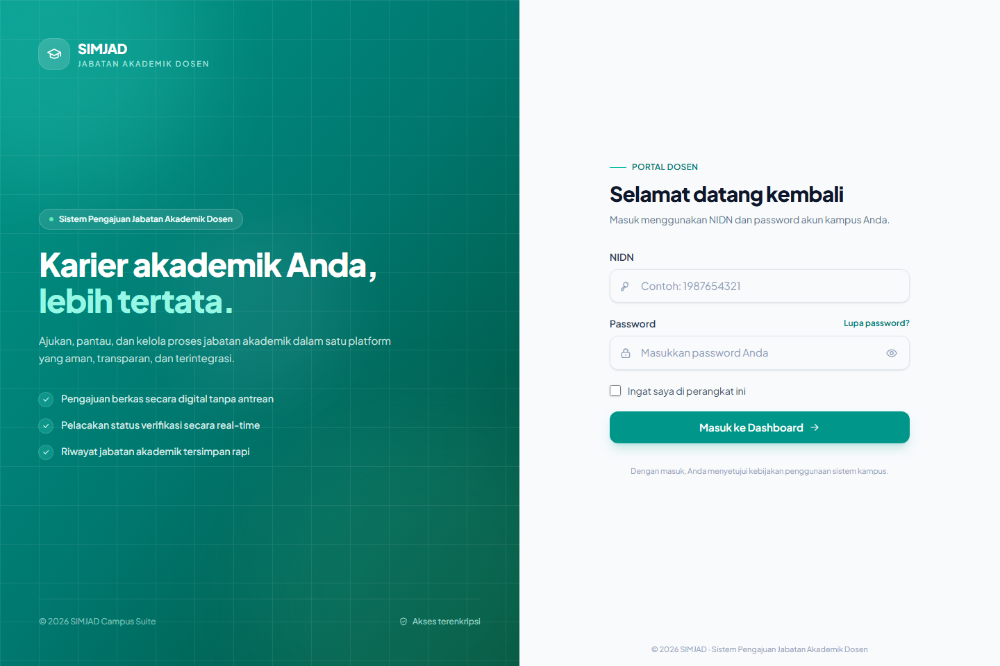

*Gambar 01. Halaman masuk: panel informasi di kiri, formulir NIDN dan password di kanan.*

Langkah masuk:

1. Isi **NIDN** — gunakan NIDN yang terdaftar, bukan alamat surel.
2. Isi **Password**.
3. Bila memakai komputer pribadi, centang **Ingat saya di perangkat ini** agar tidak perlu
   mengetik ulang pada kunjungan berikutnya. Jangan centang pada komputer bersama.
4. Tekan **Masuk**.

Bila NIDN atau password salah, aplikasi menampilkan pesan kesalahan di bawah kolom yang
bermasalah dan isian NIDN tetap tersimpan sehingga Anda hanya perlu memperbaiki password.

> **Catatan** — Halaman masuk tidak menyediakan tombol lupa password. Permintaan reset
> password dilakukan oleh admin melalui menu **Data Dosen → ubah data dosen → Password**.

## 2.2 Memilih peran (akun multi peran)

Sebagian akun memiliki lebih dari satu peran, misalnya dosen yang juga menjadi anggota
TIM PAK atau admin. Setelah masuk, akun seperti ini melihat halaman pemilihan peran.

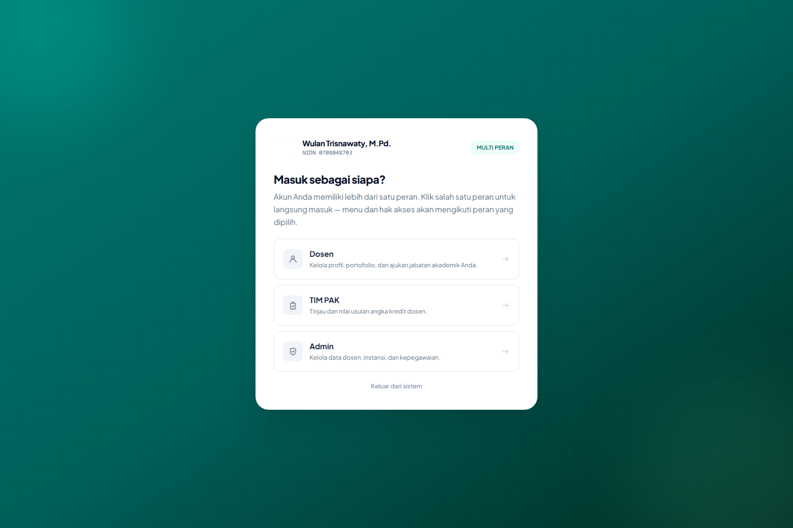

*Gambar 42. Halaman "Masuk sebagai siapa?" beserta kartu peran yang dimiliki akun.*

1. Halaman menampilkan nama dan NIDN Anda, lencana **Multi Peran**, serta pertanyaan
   **Masuk sebagai siapa?**
2. Setiap kartu berisi nama peran (Dosen, Tendik, TIM PAK, Admin) dan penjelasan singkat
   isi ruang tersebut.
3. Klik salah satu kartu. Menu dan hak akses langsung mengikuti peran yang dipilih.

Halaman ini hanya muncul sekali setelah login. Untuk berpindah peran tanpa keluar, gunakan
menu akun di sudut kanan atas → **Ganti peran**; Anda akan kembali ke halaman yang sama.

> **Peringatan** — Hak akses mengikuti peran yang sedang aktif. Bila tombol yang Anda cari
> tidak ada, periksa dulu peran aktif Anda di menu akun sebelum menghubungi admin.

## 2.3 Mengenal tata letak layar

Setelah memilih peran, semua halaman memakai tata letak yang sama:

- **Bilah samping kiri** — kelompok menu sesuai peran. Pada layar kecil bilah ini menyusut
  menjadi ikon dan dapat dibuka dengan tombol menu di kiri atas. Setiap butir menu memiliki
  keterangan muncul saat kursor diarahkan (tooltip).
- **Bilah atas** — judul halaman, tombol pintasan, dan menu akun (nama, NIDN, **Ganti peran**,
  **Keluar**). Di sisi kanan bilah atas selalu ada tombol **Buku Manual** (ikon buku) yang
  membuka buku yang sedang Anda baca ini pada tab baru; lihat "Cara membaca buku ini" di atas.
- **Area isi** — kartu putih berisi formulir atau tabel. Tabel panjang memiliki kotak
  **Cari**, saringan status, dan pemilih jumlah baris per halaman.

## 2.4 Keluar

Klik menu akun di kanan atas → **Keluar**. Sesi berakhir dan Anda kembali ke halaman masuk.
Selalu keluar setelah memakai komputer bersama atau komputer laboratorium.

---

# 3. Dashboard

Dashboard adalah halaman pertama setelah masuk. Isinya bergantung pada peran aktif.

## 3.1 Dashboard dosen

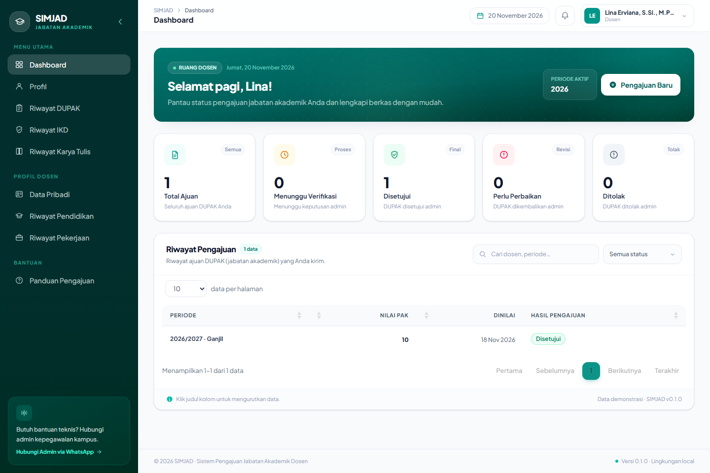

*Gambar 02. Dashboard dosen: sapaan, periode aktif, tombol pengajuan, kartu ringkasan, dan tabel riwayat.*

Bagian atas berisi:

- Lencana **Ruang Dosen** dan tanggal hari ini (format *Jumat, 20 November 2026*).
- Sapaan waktu (**Selamat pagi/siang/sore/malam, <nama depan>**) dengan penjelasan singkat
  tugas Anda pada periode berjalan.
- Kotak **Periode aktif** berisi tahun berjalan.
- Tombol putih **Buat Pengajuan** menuju pemilihan periode, dan tombol **Soon** untuk modul
  pengajuan segera hadir.

Di bawahnya ada lima kartu ringkasan pengajuan:

| Kartu | Arti |
| --- | --- |
| **Total Ajuan** | Seluruh ajuan DUPAK Anda. |
| **Menunggu Verifikasi** | DUPAK yang sudah diajukan dan menunggu keputusan admin. |
| **Disetujui** | DUPAK yang telah disetujui admin. |
| **Perlu Perbaikan** | DUPAK yang dikembalikan admin untuk dibetulkan. |
| **Ditolak** | DUPAK yang ditolak beserta alasannya. |

Kartu bersifat ringkasan; klik untuk melihat daftar yang sesuai. Tabel **Riwayat Pengajuan**
di bawahnya menampilkan periode, tanggal, status berwarna, dan tombol aksi. Gunakan kotak
**Cari** atau saringan **Semua status** untuk mempersempit daftar. Bila periode belum punya
nilai PAK, tabel menampilkan keterangan *"DUPAK bisa diajukan setelah nilai PAK periode
tersebut tersedia."*

## 3.2 Dashboard admin

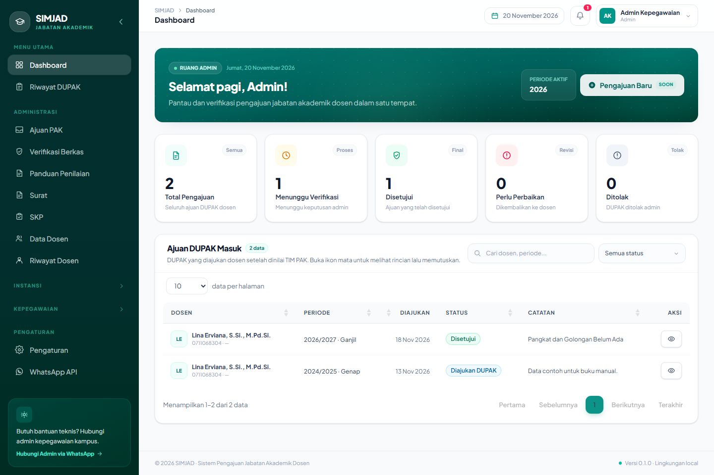

*Gambar 20. Ruang Admin: ringkasan seluruh ajuan dosen dan tabel DUPAK terbaru.*

Admin melihat sapaan **Ruang Admin**, periode aktif, dan tombol **Buat Pengajuan** yang
mengarah ke data ajuan. Lima kartu ringkasan berisi **Total Pengajuan**, **Menunggu
Verifikasi**, **Disetujui**, **Perlu Perbaikan**, dan **Ditolak** untuk seluruh dosen.

Di bagian bawah, kartu **DUPAK** memuat daftar pengajuan terbaru: nama dosen, periode, status,
dan tombol bermata (lihat DUPAK) menuju halaman detail verifikasi. Kotak **Cari** dan saringan
status bekerja seperti pada tabel lain.

## 3.3 Dashboard TIM PAK

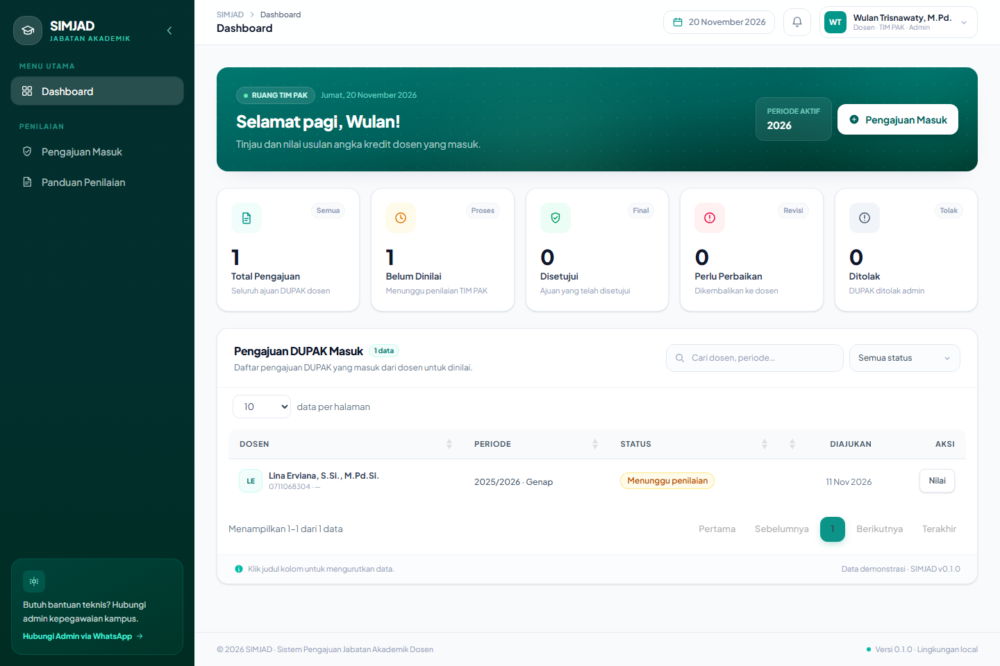

*Gambar 43. Ruang TIM PAK: antrean pengajuan yang belum dinilai.*

TIM PAK melihat **Ruang TIM PAK**, tombol **Pengajuan Masuk**, dan kartu **Belum Dinilai**
yang berisi jumlah usulan yang menunggu penilaian. Tabel **Pengajuan DUPAK Masuk** di bawahnya
memuat daftar usulan beserta status dan tombol menuju formulir penilaian. Rincian pekerjaan
penilaian dijelaskan pada Bab 12.

---

# 4. Profil dan portofolio dosen

Menu yang dibahas pada bab ini ada di kelompok **Profil** dan **Profil Dosen** pada bilah
samping: **Data Pribadi**, **Riwayat Pendidikan**, **Riwayat Pekerjaan**, serta
**Riwayat Karya Tulis** pada kelompok **Menu Utama**.

> **Catatan** — Lengkapi profil sebelum mengisi kegiatan. Data pribadi, pendidikan, dan
> kepangkatan dipakai sebagai isi halaman muka DUPAK serta bahan surat yang dibuat admin.

## 4.1 Portofolio dosen

Klik **Profil** pada kelompok Menu Utama.

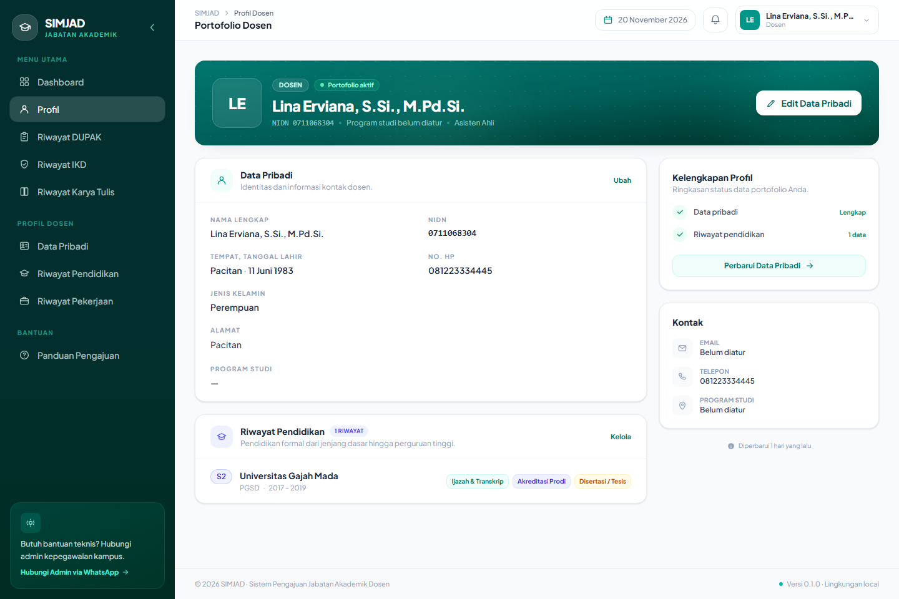

*Gambar 03. Portofolio dosen: kartu identitas, ringkasan data pribadi, kelengkapan profil, dan riwayat pendidikan.*

Halaman ini adalah ringkasan seluruh data Anda:

- **Kartu identitas berwarna hijau** — inisial nama, lencana **DOSEN**, lencana
  **Portofolio aktif**, nama lengkap beserta gelar, NIDN, program studi, dan jabatan
  akademik saat ini (contoh: *Asisten Ahli*). Tombol **Edit Data Pribadi** di kanan atas
  membuka formulir data pribadi.
- **Kartu Data Pribadi** — nama lengkap, NIDN, tempat dan tanggal lahir, nomor HP, jenis
  kelamin, alamat, dan program studi. Tautan **Ubah** di kanan atas kartu menuju formulir
  yang sama dengan tombol sebelumnya.
- **Kartu Kelengkapan Profil** — daftar periksa berisi **Data pribadi** dan **Riwayat
  pendidikan**. Tanda centang hijau berarti sudah lengkap; teks **Lengkap** atau jumlah data
  (contoh: *1 data*) tampil di sisi kanan. Tombol **Perbarui Data Pribadi →** ada di bawah
  daftar.
- **Kartu Kontak** — surel, telepon, dan program studi. Tulisan **Belum diatur** berarti data
  tersebut belum diisi.
- **Kartu Riwayat Pendidikan** — ringkasan jenjang tertinggi beserta lencana berkas
  (**Ijazah & Transkrip**, **Akreditasi Prodi**, **Disertasi / Tesis**). Tautan **Kelola**
  membuka halaman riwayat pendidikan.
- Keterangan **Diperbarui … yang lalu** di bawah kartu kanan menunjukkan kapan data terakhir
  diubah.

## 4.2 Data pribadi

Buka **Profil Dosen → Data Pribadi**, atau tekan **Edit Data Pribadi** pada portofolio.

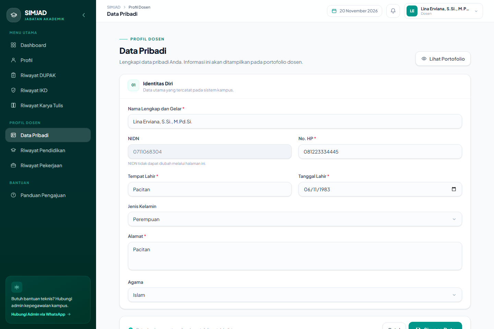

*Gambar 04. Formulir data pribadi dosen.*

Isian yang tersedia:

| Isian | Wajib | Keterangan |
| --- | --- | --- |
| **Nama Lengkap dan Gelar** | Ya | Tulis nama beserta gelar, contoh `Lina Erviana, S.Si., M.Pd.Si.` |
| **NIDN** | — | Mengikuti akun, tidak dapat diubah sendiri. |
| **No. HP** | Ya | Dipakai admin untuk menghubungi Anda melalui WhatsApp. |
| **Tempat Lahir** | Ya | |
| **Tanggal Lahir** | Ya | Format tanggal `dd/mm/yyyy` pada pemilih tanggal. |
| **Jenis Kelamin** | — | Dropdown dengan pencarian **Cari jenis kelamin…**. |
| **Alamat** | Ya | Alamat lengkap tempat tinggal saat ini. |
| **Agama** | — | Dropdown dengan pencarian **Cari agama…**. |

Tekan **Simpan Data**. Bila ada isian yang belum benar, muncul kotak merah
**"Periksa kembali data Anda."** beserta jumlah isian yang perlu diperbaiki; kolom bermasalah
ditandai bingkai merah dan pesan di bawahnya. Setelah tersimpan, data langsung tampil pada
portofolio — sesuai keterangan pada formulir, *"Data akan langsung tampil pada portofolio
setelah disimpan."*

## 4.3 Riwayat pendidikan

Buka **Profil Dosen → Riwayat Pendidikan**.

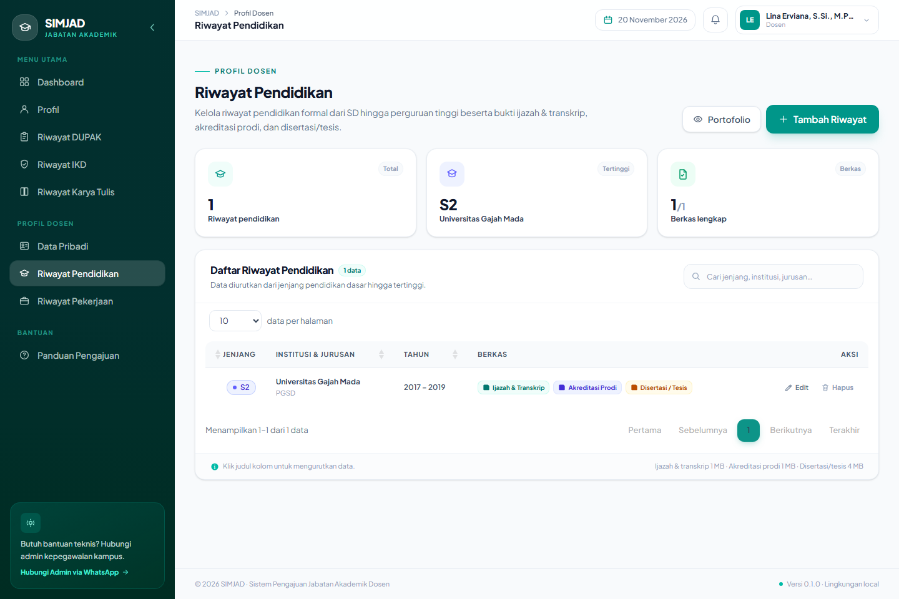

*Gambar 05. Halaman riwayat pendidikan: kartu ringkasan di atas, tabel riwayat di bawah.*

Tiga kartu ringkasan di bagian atas:

| Kartu | Isi |
| --- | --- |
| **Total** | Jumlah riwayat pendidikan yang tercatat (contoh: *1 Riwayat pendidikan*). |
| **Tertinggi** | Jenjang dan institusi tertinggi (contoh: *S2 — Universitas Gajah Mada*). |
| **Berkas** | Perbandingan berkas lengkap terhadap jumlah riwayat (contoh: *1/1 Berkas lengkap*). |

Tabel **Daftar Riwayat Pendidikan** memuat kolom **Jenjang**, **Institusi & Jurusan**,
**Tahun**, **Berkas**, dan **Aksi**. Data diurutkan dari jenjang pendidikan dasar ke
tertinggi. Klik judul kolom untuk mengurutkan, gunakan kotak **Cari jenjang, institusi,
jurusan…** untuk menyaring, dan pilih jumlah baris melalui pemilih **data per halaman**.
Catatan di bawah tabel menyebut batas ukuran berkas: *Ijazah & transkrip 1 MB · Akreditasi
prodi 1 MB · Disertasi/Tesis 4 MB*.

Tombol **+ Tambah Riwayat** di kanan atas membuka formulir baru; ikon pensil mengubah data,
ikon tempat sampah menghapusnya setelah konfirmasi. Tombol **Portofolio** mengembalikan Anda
ke halaman ringkasan.

### Menambah riwayat pendidikan

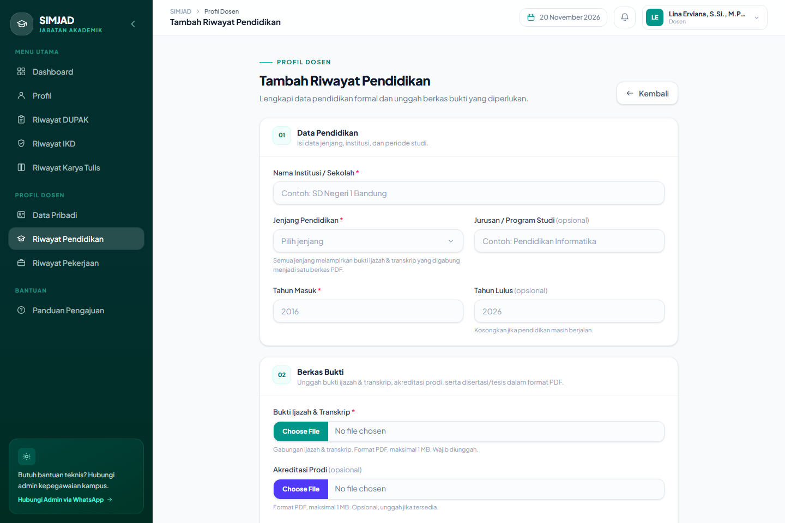

*Gambar 06. Formulir tambah riwayat pendidikan: bagian Data Pendidikan dan Berkas Bukti.*

1. **Data Pendidikan**
   - **Nama Institusi / Sekolah** — contoh pada kolom: *SD Negeri 1 Bandung*.
   - **Jenjang Pendidikan** — pilih dari dropdown **Pilih jenjang**. Semua jenjang wajib
     melampirkan bukti ijazah & transkrip yang digabung menjadi satu berkas PDF.
   - **Jurusan / Program Studi** (opsional) — contoh: *Pendidikan Informatika*.
   - **Tahun Masuk** dan **Tahun Lulus** (opsional). Kosongkan tahun lulus bila pendidikan
     masih berjalan.
2. **Berkas Bukti** — unggah dalam format PDF:
   - **Bukti Ijazah & Transkrip** (wajib, maksimal 1 MB) — gabungan ijazah dan transkrip.
   - **Akreditasi Prodi** (opsional, maksimal 1 MB) — unggah bila tersedia.
   - **Disertasi / Tesis** (opsional, maksimal 4 MB) — untuk jenjang S2/S3.
3. Tekan **Simpan** untuk menyimpan, atau **Kembali** untuk membatalkan.

Saat mengubah data yang sudah ada, tiap isian berkas menampilkan **Berkas saat ini** dengan
tautan **Lihat**. Kosongkan pemilih berkas jika tidak ingin mengganti berkas lama. Berkas
disimpan otomatis dengan nama yang memuat NIDN Anda dan hanya dapat diakses oleh pemilik akun.

## 4.4 Riwayat pekerjaan dan kepangkatan

Buka **Profil Dosen → Riwayat Pekerjaan**.

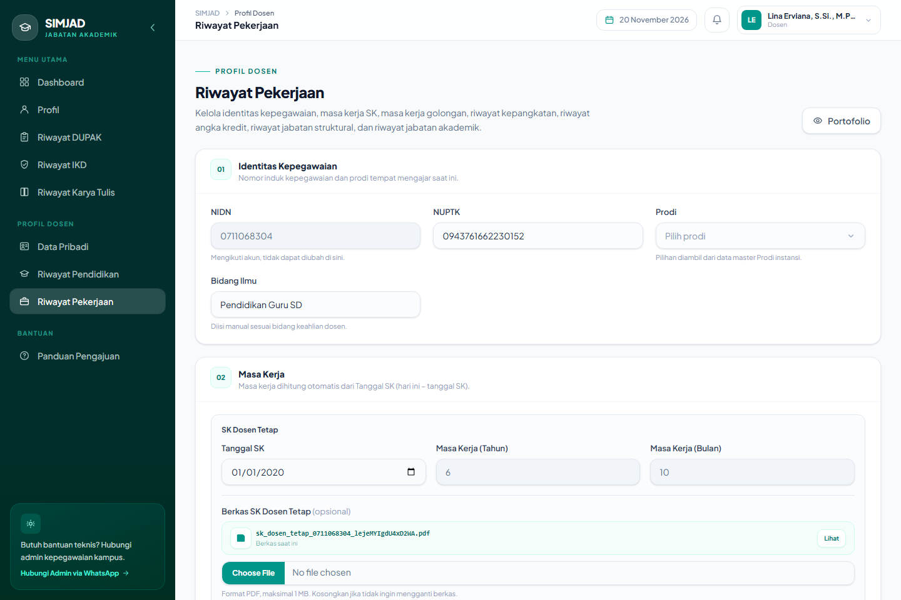

*Gambar 07. Riwayat pekerjaan: identitas kepegawaian, masa kerja SK, dan masa kerja golongan.*

Halaman ini menggabungkan tujuh bagian bernomor. Bagian yang tampak pada gambar:

1. **Identitas Kepegawaian** — **NIDN** (mengikuti akun, tidak dapat diubah di sini),
   **NUPTK**, **Prodi** (pilihan diambil dari data master Prodi instansi), dan **Bidang Ilmu**
   (diisi manual sesuai bidang keahlian).
2. **Masa Kerja** — **Tanggal SK** dosen tetap; **Masa Kerja (Tahun)** dan **Masa Kerja
   (Bulan)** dihitung otomatis dari tanggal SK sampai hari ini. Berkas **SK Dosen Tetap**
   bersifat opsional (PDF maksimal 1 MB); bila sudah ada, nama berkas tampil dengan tombol
   **Lihat**, dan cukup dibiarkan kosong bila tidak ingin menggantinya.

Bagian berikutnya di halaman yang sama:

3. **Masa Kerja Golongan** — tanggal SK golongan beserta perhitungan masa kerja golongan.
4. **Riwayat Kepangkatan** — tabel **Pangkat & Golongan**, **TMT**, dan **Aksi**. Isi
   formulir **Tambah**, lalu tekan **Tambah** untuk menyimpan, atau **Simpan Perubahan**
   saat menyunting. Tombol **Batal Edit** membatalkan penyuntingan. Ikon tempat sampah
   menghapus baris setelah konfirmasi.
5. **Riwayat Angka Kredit** — tabel **Tahun Pengajuan** dan **Angka Kredit** dengan pola
   tombol yang sama.
6. **Riwayat Jabatan Struktural** — tabel **Jabatan Struktural** dan **TMT**.
7. **Riwayat Jabatan Akademik** — riwayat jabatan fungsional dosen.

Tautan **SK** di bagian atas halaman membuka dokumen SK pada tab baru. Tombol **Portofolio**
kembali ke halaman ringkasan.

## 4.5 Status jabatan akademik saat mengajukan

Langkah pertama pengajuan baru menampilkan status jabatan akademik Anda.

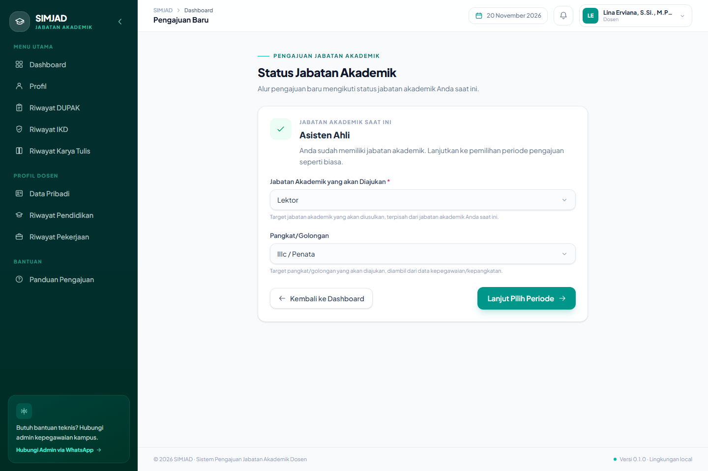

*Gambar 08. Halaman Status Jabatan Akademik: jabatan saat ini dan target yang diusulkan.*

- Kartu **JABATAN AKADEMIK SAAT INI** menampilkan jabatan yang sedang dipegang (contoh:
  *Asisten Ahli*) beserta penjelasan: *"Anda sudah memiliki jabatan akademik. Lanjutkan ke
  pemilihan periode pengajuan seperti biasa."* Dosen yang belum memiliki jabatan akademik
  melihat arahan berbeda, yaitu melengkapi berkas IKD lebih dulu.
- **Jabatan Akademik yang akan Diajukan** — pilih target, misalnya *Lektor*. Keterangan di
  bawah kolom: *"Target jabatan akademik yang akan diusulkan, terpisah dari jabatan akademik
  Anda saat ini."*
- **Pangkat/Golongan** — pilihan diambil dari data kepegawaian/kepangkatan, misalnya
  *IIIc / Penata*.
- Tekan **Lanjut Pilih Periode →** untuk meneruskan, atau **← Kembali ke Dashboard** untuk
  membatalkan.

## 4.6 Riwayat karya tulis

Buka **Menu Utama → Riwayat Karya Tulis**.

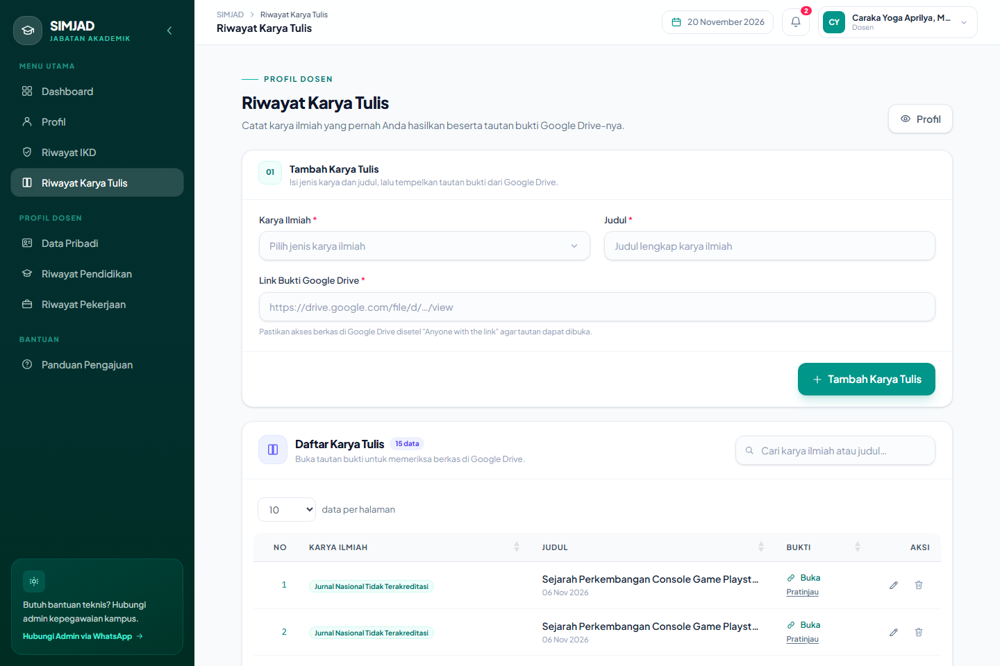

*Gambar 17. Riwayat karya tulis: formulir tambah di atas, daftar karya di bawah.*

Bagian **01 Tambah Karya Tulis** berisi:

- **Karya Ilmiah** — dropdown **Pilih jenis karya ilmiah**. Pilihan mengikuti jenis yang
  dipakai pada kegiatan DUPAK, misalnya *Jurnal Nasional Tidak Terakreditasi*, *Jurnal Ilmiah
  Internasional*, *Seminar Nasional*, atau *Buku Referensi*.
- **Judul** — judul lengkap karya.
- **Link Bukti Google Drive** — contoh format `https://drive.google.com/file/d/…/view`.
  Pastikan akses berkas disetel *"Anyone with the link"* agar tautan dapat dibuka.
- Untuk jurnal dan prosiding, tersedia pula isian **Nama Jurnal**/**Nama Prosiding** dan
  **ISSN** (opsional).
- Tekan **+ Tambah Karya Tulis**.

Tabel **Daftar Karya Tulis** menampilkan jumlah data, kolom **No**, **Karya Ilmiah**,
**Judul** (beserta tanggal pencatatan), **Bukti**, dan **Aksi**. Kolom **Bukti** berisi
tautan **Buka** (membuka Google Drive) dan **Pratinjau**. Ikon pensil menyunting, ikon tempat
sampah menghapus setelah konfirmasi. Gunakan kotak **Cari karya ilmiah atau judul…** untuk
menyaring daftar. Tombol **Profil** di kanan atas kembali ke portofolio.

---

# 5. Pengajuan DUPAK

Bab ini adalah inti pekerjaan dosen. Alurnya berurutan: pilih jabatan yang diusulkan →
tentukan periode → tentukan masa penilaian → isi komponen kegiatan → periksa di tab Review →
ajukan ke TIM PAK. Setelah dinilai, ajukan DUPAK dan cetak hasilnya.

> **Catatan** — Menu **Riwayat DUPAK** pada bilah samping membuka halaman yang sama dengan
> tombol **Buat Pengajuan** di dashboard. Bila Anda belum memiliki jabatan akademik, aplikasi
> mengarahkan ke tahap IKD (Bab 6) lebih dulu.

## 5.1 Memilih periode pengajuan

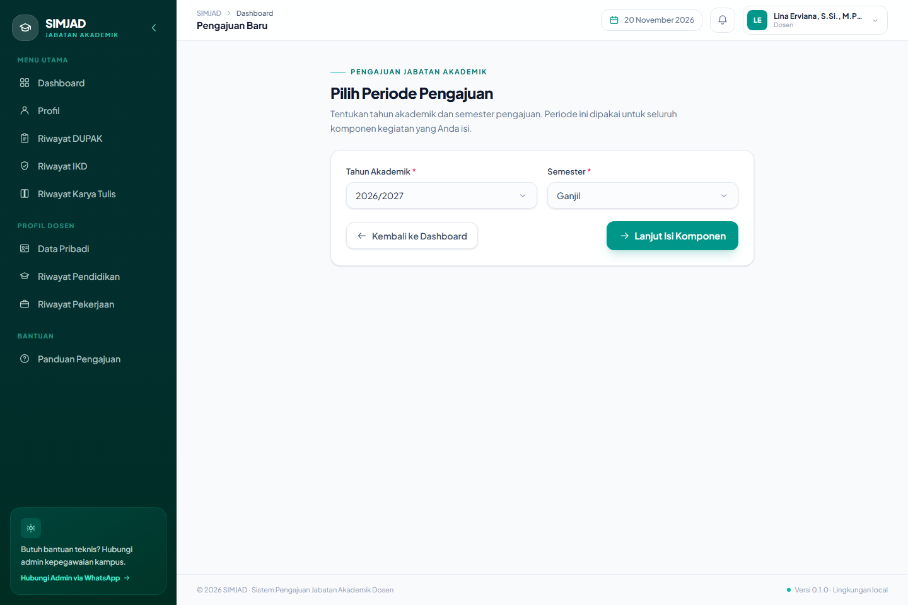

*Gambar 09. Halaman Pilih Periode Pengajuan.*

1. **Tahun Akademik** — pilih dari dropdown, misalnya `2026/2027`.
2. **Semester** — pilih **Ganjil** atau **Genap**.
3. Tekan **Lanjut Isi Komponen →** untuk meneruskan, atau **← Kembali ke Dashboard**.

Keterangan halaman menjelaskan bahwa periode ini dipakai untuk seluruh komponen kegiatan yang
Anda isi. Satu kombinasi tahun akademik dan semester hanya dapat dipakai satu kali; bila
periode sudah pernah diajukan, aplikasi menolak dan menyarankan periode lain.

## 5.2 Menentukan masa penilaian

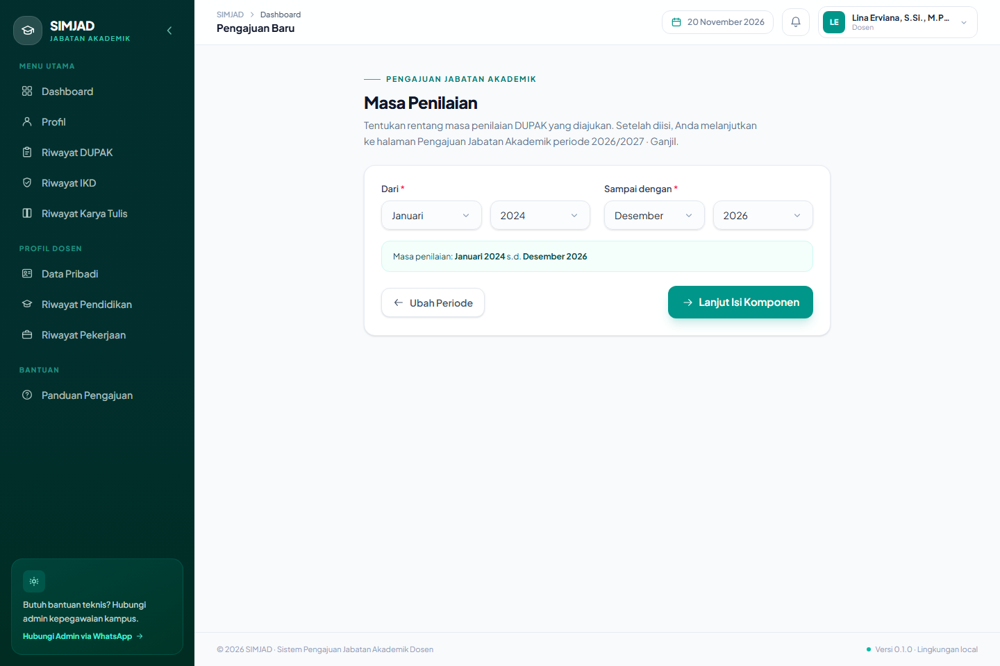

*Gambar 10. Halaman Masa Penilaian: rentang bulan dan tahun penilaian DUPAK.*

1. **Dari** — pilih bulan dan tahun awal, misalnya *Januari 2024*.
2. **Sampai dengan** — pilih bulan dan tahun akhir, misalnya *Desember 2026*.
3. Kotak hijau di bawahnya menampilkan ringkasan, contoh: *"Masa penilaian: Januari 2024 s.d.
   Desember 2026"*. Periksa kembali sebelum melanjutkan.
4. Tekan **Lanjut Isi Komponen →**, atau **← Ubah Periode** untuk kembali ke langkah
   sebelumnya.

Rentang ini tercetak pada halaman muka DUPAK, jadi pastikan sesuai dengan periode kinerja
yang Anda usulkan.

## 5.3 Formulir kegiatan: tab komponen

Setelah masa penilaian ditetapkan, Anda masuk ke halaman **Pengajuan Baru**.

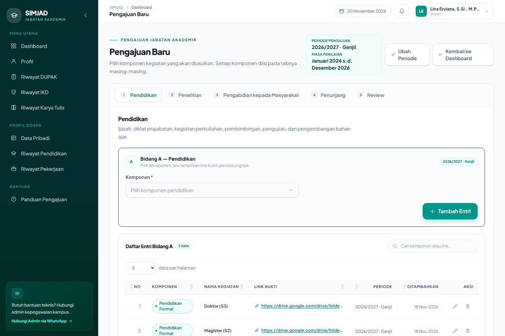

*Gambar 11. Halaman Pengajuan Baru: ringkasan periode di kanan atas dan lima tab komponen.*

Panel kanan atas menampilkan **PERIODE PENGAJUAN** (contoh: *2026/2027 · Ganjil*) dan **MASA
PENILAIAN** (*Januari 2024 s.d. Desember 2026*). Dua tombol di sampingnya: **Ubah Periode**
dan **Kembali ke Dashboard**.

Lima tab di bawahnya:

| Tab | Bidang | Cakupan menurut aplikasi |
| --- | --- | --- |
| **1 Pendidikan** | Bidang A | Ijazah, diklat prajabatan, kegiatan perkuliahan, pembimbingan, pengujian, dan pengembangan bahan ajar. |
| **2 Penelitian** | Bidang C | Hasil penelitian, publikasi ilmiah, buku ajar, dan kekayaan intelektual yang diakui. |
| **3 Pengabdian kepada Masyarakat** | Bidang D | Kegiatan pengabdian kepada masyarakat beserta hasil dan bukti pelaksanaannya. |
| **4 Penunjang** | Bidang E | Organisasi profesi, penghargaan, dan tugas tambahan. |
| **5 Review** | — | Rekap seluruh entri dari keempat bidang dalam satu formulir. |

> **Catatan** — Tab **Pendidikan** memuat dua bidang sekaligus: Bidang A (Pendidikan) dan
> Bidang B (Pelaksanaan Pendidikan). Keduanya diisi pada tab yang sama dengan dua kartu
> formulir terpisah.

Setiap tab berisi dua bagian: kartu formulir **Bidang X — <nama bidang>** untuk menambah
entri, dan tabel **Daftar Entri Bidang X** berisi entri yang sudah tersimpan.

### Menambah satu entri kegiatan

1. Pada kartu formulir, pilih **Komponen** (wajib). Contoh pilihan pada Bidang A:
   **Pendidikan Formal** atau **Pendidikan dan Pelatihan Prajabatan**.
2. Bila komponen memiliki rincian, dropdown **Pilih rincian komponen** dan **Pilih rincian
   kegiatan** akan muncul dan harus dipilih. Contoh pada Bidang C: komponen *Menghasilkan
   Karya Ilmiah* → rincian *Hasil Penelitian yang Dipublikasikan* → rincian kegiatan *Jurnal
   Ilmiah Nasional Terakreditasi*.
3. Isi **Nama Kegiatan** — tulis nama kegiatan secara spesifik agar mudah dinilai, misalnya
   *Menyadur Buku Jokowi Tukang Kibul* atau *Mengajar Kelas B 6 sks*.
4. Isi **Link Bukti** — tautan Google Drive berisi berkas pendukung. Contoh format pada kolom:
   `https://drive.google.com/file/d/…/view`. Pastikan tautan dapat dibuka oleh penilai.
5. Tekan **+ Tambah Entri**. Entri langsung muncul pada tabel di bawah formulir dan formulir
   kembali kosong untuk entri berikutnya.

Entri yang sudah tersimpan dapat diubah lewat ikon pensil atau dihapus lewat ikon tempat
sampah (dengan konfirmasi). Kotak **Cari komponen atau link…** menyaring tabel, dan pemilih
**data per halaman** mengatur jumlah baris yang ditampilkan.

### Pilihan komponen tiap bidang

Daftar berikut diambil langsung dari aplikasi, sehingga sama dengan isi dropdown di layar.

**Bidang A — Pendidikan**

- Pendidikan Formal
- Pendidikan dan Pelatihan Prajabatan

**Bidang B — Pelaksanaan Pendidikan**

- Melaksanakan Perkuliahan
- Membimbing Seminar Mahasiswa
- Membimbing PKL/KKN/PKN
- Membimbing dan Ikut Membimbing dalam Menghasilkan Desertasi, Thesis, Skripsi, dan Laporan
  Akhir Studi — rincian: *Pembimbing Utama*, *Pembimbing Pendamping*
- Penguji pada Ujian Akhir — rincian: *Ketua Penguji*, *Anggota Penguji*
- Membina Kegiatan Mahasiswa
- Mengembangkan Program Kuliah
- Mengembangkan Bahan Ajar — rincian: *Buku Ajar*, *Modul/Petunjuk Praktikum/Diktat/Audio
  Visual/Naskah Tutorial*
- Menyampaikan Orasi Ilmiah
- Menduduki Jabatan Pimpinan Perguruan Tinggi
- Membimbing Dosen yang Lebih Rendah Jabatan Fungsionalnya
- Melaksanakan Kegiatan Datasering dan Pencangkokan Akademik Dosen
- Melakukan Kegiatan Pengembangan Diri untuk Meningkatkan Kompetensi

**Bidang C — Penelitian**

- Menghasilkan Karya Ilmiah — rincian: *Hasil Penelitian yang Dipublikasikan*, *Hasil
  Penelitian atau Hasil Pemikiran yang Tidak Dipublikasikan*
- Menerjemahkan atau Menyadur Buku Ilmiah
- Mengedit/Menyunting Buku Ilmiah
- Membuat Rencana dan Karya Teknologi yang Dipatenkan
- Membuat Rancangan dan Karya Teknologi
- Rancangan dan Karya Seni Monumental/Pertunjukan/Karya Sastra — rincian: *Internasional*,
  *Nasional*, *Lokal*

Untuk rincian *Hasil Penelitian yang Dipublikasikan* tersedia pilihan tingkat ketiga:
*Buku Referensi*, *Jurnal Ilmiah Internasional*, *Jurnal Ilmiah Nasional Terakreditasi*,
*Jurnal Ilmiah Nasional Tidak Terakreditasi*, *Seminar Internasional*, *Seminar Nasional*,
*Koran atau Majalah Umum*.

**Bidang D — Pengabdian kepada Masyarakat**

- Menduduki Jabatan Pimpinan
- Melaksanakan Pengembangan Hasil Pendidikan dan Penelitian
- Memberikan Latihan/Penyuluhan/Penataran/Ceramah pada Masyarakat — rincian: *Terjadwal
  dalam Satu Semester atau Lebih*, *Terjadwal Kurang dari Satu Semester*
- Memberi Pelayanan kepada Masyarakat atau Kegiatan Lain yang Menunjang Pelaksanaan Tujuan
  Umum Pemerintah dan Pembangunan
- Membuat atau Menulis Karya Pengabdian

**Bidang E — Penunjang**

- Menjadi Anggota dalam Suatu Panitia/Badan pada Perguruan Tinggi — rincian: *Sebagai
  Ketua/Wakil Ketua Merangkap Anggota*, *Sebagai Anggota*
- Menjadi Anggota Panitia/Badan pada Lembaga Pemerintah — rincian: *Panitia Pusat*,
  *Panitia Daerah*
- Menjadi Anggota Organisasi Profesi — rincian: *Tingkat Internasional*, *Tingkat Nasional*
- Mewakili Perguruan Tinggi/Lembaga Pemerintah Duduk dalam Panitia Antar Lembaga
- Menjadi Anggota Delegasi Nasional ke Pertemuan Internasional — rincian: *Ketua Delegasi*,
  *Anggota Delegasi*
- Berperan Aktif dalam Pertemuan Ilmiah — rincian: *Tingkat Internasional/Nasional/Regional*,
  *Di Lingkungan Perguruan Tinggi*
- Mendapatkan Penghargaan/Tanda Jasa — rincian: *Penghargaan/Tanda Jasa Satya Lancana Karya
  Satya*, *Memperoleh Penghargaan Lainnya*
- Menulis Buku Pelajaran SMA ke Bawah yang Diterbitkan dan Diedarkan Secara Nasional —
  rincian: *SMA Sederajat*, *SMP Sederajat*, *SD Sederajat*
- Mempunyai Prestasi di Bidang Olahraga/Humaniora — rincian: *Tingkat Internasional*,
  *Tingkat Nasional*
- Keanggotaan dalam Tim Penilaian Jabatan Akademik

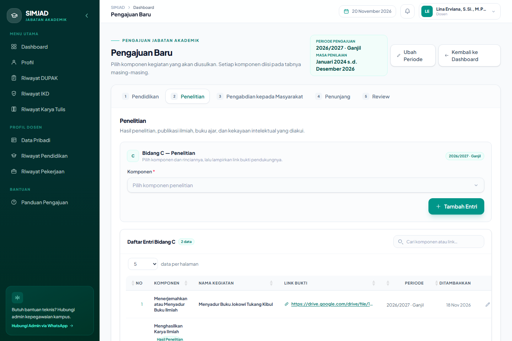

*Gambar 12. Tab Penelitian (Bidang C) setelah beberapa entri ditambahkan. Kolom tabel: No, Komponen, Nama Kegiatan, Link Bukti, Periode, Ditambahkan, Aksi.*

## 5.4 Memeriksa tab Review

Klik tab **5 Review**.

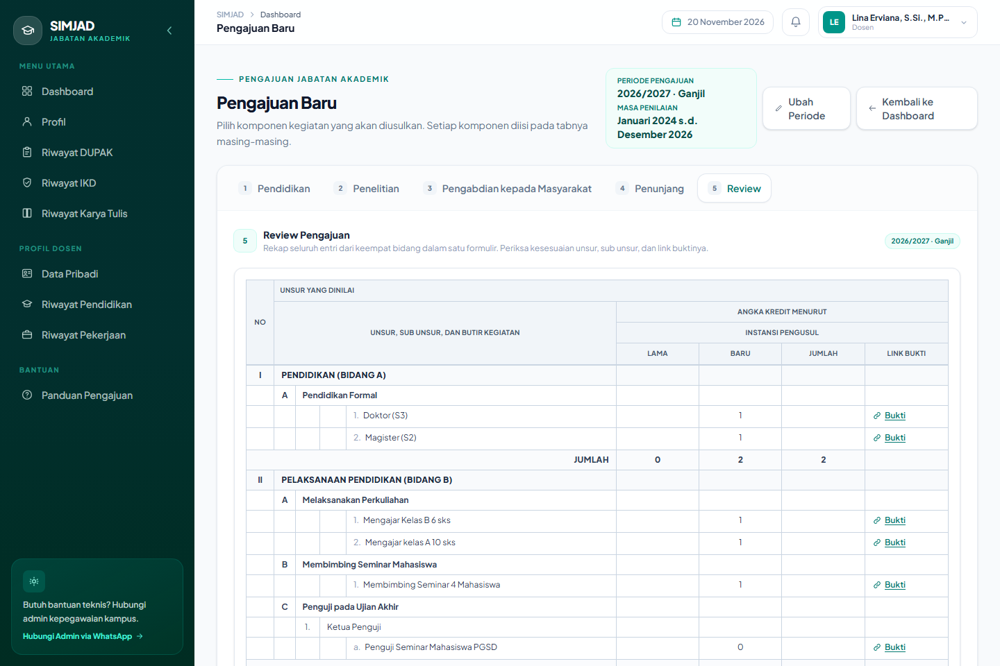

*Gambar 13. Tab Review: rekap seluruh entri dalam bentuk tabel DUPAK.*

Keterangan bagian atas: *"Rekap seluruh entri dari keempat bidang dalam satu formulir. Periksa
kesesuaian unsur, sub unsur, dan link buktinya."* Lencana di kanan atas menampilkan periode
(*2026/2027 · Ganjil*).

Tabel rekap memakai susunan resmi DUPAK:

- **No** — nomor unsur, misalnya *I*, *II*.
- **Unsur, Sub Unsur, dan Butir Kegiatan** — dikelompokkan per bidang: **PENDIDIKAN (BIDANG
  A)**, **PELAKSANAAN PENDIDIKAN (BIDANG B)**, lalu bidang C, D, dan E. Tiap baris menampilkan
  komponen dan nama kegiatan yang Anda isi, misalnya *1. Doktor (S3)* atau *Mengajar Kelas B
  6 sks*.
- **Angka Kredit Menurut → Instansi Pengusul** dengan kolom **Lama**, **Baru**, **Jumlah**.
  Kolom **Lama** berisi nilai yang sudah dimiliki, kolom **Baru** diisi TIM PAK.
- **Link Bukti** — tombol **Bukti** pada tiap baris membuka tautan Google Drive yang Anda
  lampirkan.
- Baris **JUMLAH** di akhir setiap bidang menjumlahkan angka kredit bidang tersebut.

Bila ada entri yang salah, kembali ke tab bidangnya (1–4), tekan ikon pensil pada entri, betulkan,
lalu simpan. Tab Review selalu menampilkan data terbaru.

## 5.5 Mengajukan usulan ke TIM PAK

Panel bawah tab Review berisi **Status usulan:** beserta lencana status. Saat periode baru
dibuat, statusnya **Belum diajukan**. Bila sudah dinilai, di sebelah status tampil keterangan
tanggal, contoh *dinilai 18 Nov 2026*.

Tiga tombol pada panel:

| Tombol | Fungsi | Aktif bila |
| --- | --- | --- |
| **Ajukan ke TIM PAK** | Mengirim usulan periode ini untuk dinilai. | Belum terkunci oleh keputusan admin. |
| **Ajukan Dupak** | Meneruskan DUPAK ke admin memakai nilai dari TIM PAK. | Status **Sudah dinilai**. |
| **Cetak Dupak ke PDF** | Membuka halaman cetak DUPAK pada tab baru. | Selalu tersedia. |

Langkah mengajukan ke TIM PAK:

1. Tekan **Ajukan ke TIM PAK**.
2. Muncul konfirmasi berjudul **Ajukan ke TIM PAK?** dengan pesan *"Usulan periode ini akan
   dikirim ke TIM PAK untuk dinilai."* Setujui.
3. Status berubah menjadi **Menunggu penilaian** dan tanggal pengajuan tercatat.

> **Peringatan** — Periode tanpa entri tidak dapat diajukan. Aplikasi menolak dengan pesan
> *"Belum ada kegiatan pada periode ini yang bisa diajukan"*. Tambahkan minimal satu entri
> terlebih dahulu.

## 5.6 Setelah dinilai: ajukan DUPAK

1. Tunggu hingga TIM PAK menyelesaikan penilaian. Status berubah menjadi **Sudah dinilai**
   dan tombol **Ajukan Dupak** menjadi aktif.
2. Tekan **Ajukan Dupak**. Konfirmasi berjudul **Ajukan DUPAK?** menampilkan pesan *"DUPAK
   periode ini akan diajukan memakai nilai dari TIM PAK."*
3. Status berubah menjadi **Diajukan DUPAK** dan berkas masuk ke antrean admin.

DUPAK memakai nilai dari TIM PAK; dosen tidak mengisi ulang angka kredit. Setelah admin
memutuskan:

- **Disetujui** — nilai terkunci, DUPAK siap dicetak, dan tombol **Ajukan ke TIM PAK** tidak
  dapat dipakai lagi.
- **Butuh Perbaikan** — buka **Riwayat DUPAK → tab Riwayat Nilai PAK**, tekan **Perbaikan**
  pada periode tersebut, betulkan entri, lalu **Ajukan Ulang**.
- **Ditolak** — usulan dihentikan; alasan penolakan tampil pada riwayat.

## 5.7 Mencetak DUPAK ke PDF

Tekan **Cetak Dupak ke PDF** pada panel Review atau **Cetak PDF** pada tab Riwayat Ajuan
DUPAK. Aplikasi membuka halaman cetak pada tab baru tanpa menu aplikasi. Pada dialog cetak
peramban, pilih tujuan **Save as PDF**, ukuran kertas **A4**, orientasi **Landscape** (tabel
rekap lebih lebar daripada tinggi), lalu simpan.

Halaman cetak memuat kolom **Lama**, **Baru**, dan **Jumlah** di bawah grup **Tim Penilai**
serta label jumlah panjang *Jumlah (Unsur Utama + Penunjang)*, dan tidak memuat kolom **Link
Bukti**.

---

# 6. Berkas syarat khusus dan riwayat IKD

## 6.1 Kapan halaman ini dipakai

Halaman **Indikator Kinerja Dosen** (menu **Riwayat IKD**) dipakai dosen yang **belum memiliki
jabatan akademik** — yaitu pengajuan jabatan akademik pertama. Dosen yang sudah memiliki
jabatan akademik tetap dapat membuka halaman ini untuk melengkapi atau memperbarui berkas.

Dua berkas wajib diunggah, keduanya dalam format PDF:

| Berkas | Batas ukuran | Isi |
| --- | --- | --- |
| **BKD 2 Semester Terakhir (Status Memenuhi, Tridharma PT terpenuhi)** | 3 MB | Bukti Kompilasi LKD 2 semester terakhir dalam satu file PDF. |
| **Bukti Pemenuhan Indikator Kinerja Dosen** | 5 MB | Kompilasi Bukti Klaim IKD sesuai target JAD (Asisten Ahli) dari laman SISTER Dosen dalam satu file PDF, mencakup komponen [a] Pendidikan (kegiatan pembelajaran, pengajaran, dan pengembangan akademik) dan [b] Penelitian & Pengmas (kontribusi langsung kepada masyarakat dan penerapan ilmu). |

## 6.2 Mengunggah berkas

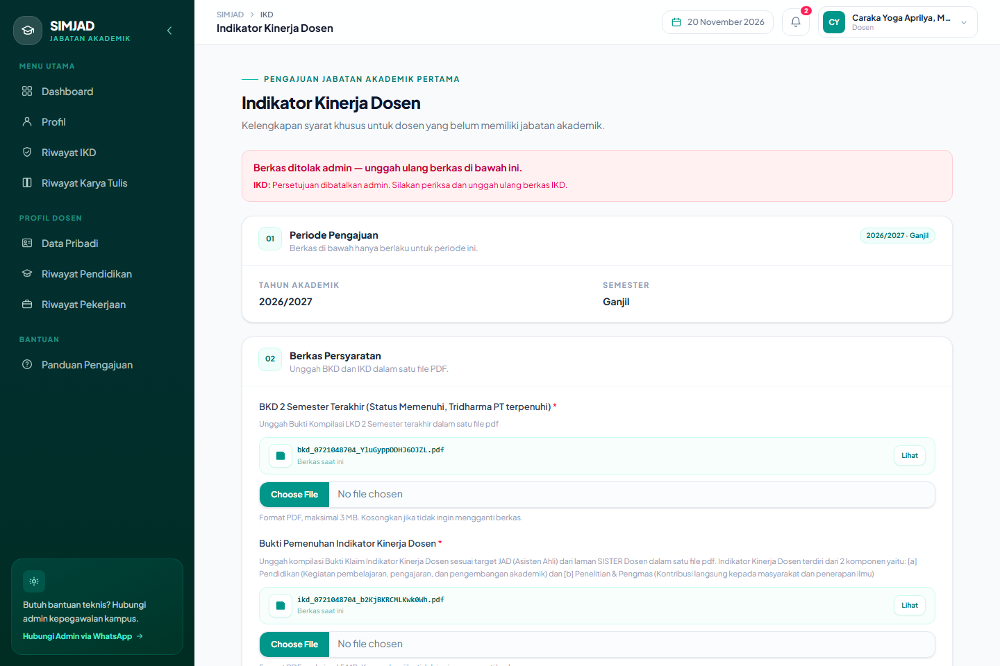

*Gambar 18. Halaman Indikator Kinerja Dosen: periode pengajuan, dua berkas wajib, dan tabel berkas tersimpan.*

Halaman dibuka dengan judul **Indikator Kinerja Dosen** dan keterangan *"Kelengkapan syarat
khusus untuk dosen yang belum memiliki jabatan akademik."*

1. **01 Periode Pengajuan** — menampilkan **Tahun Akademik** (contoh *2026/2027*) dan
   **Semester** (*Ganjil*) yang sedang diisi. Keterangan: *"Berkas di bawah hanya berlaku untuk
   periode ini."* Lencana periode tampil di kanan atas bagian.
2. **02 Berkas Persyaratan** — *"Unggah BKD dan IKD dalam satu file PDF."* Untuk setiap berkas:
   - Bila sudah ada berkas tersimpan, nama berkas tampil pada kotak hijau dengan tombol
     **Lihat** dan keterangan **Berkas saat ini**.
   - Pilih berkas baru melalui tombol **Choose File**; keterangan di bawahnya menyebut format
     dan batas ukuran serta pesan *"Kosongkan jika tidak ingin mengganti berkas."*
   - Tekan **Simpan Berkas**.

Bila ada isian bermasalah, muncul kotak *"Terdapat N isian yang perlu diperbaiki sebelum berkas
dapat disimpan."* Berkas yang sudah diajukan akan terkunci: aplikasi menampilkan pesan
**"Berkas periode ini sudah diajukan"** beserta status dan keterangan *"Berkas tidak dapat
diubah selama menunggu verifikasi admin."*

Bila admin menolak berkas, halaman menampilkan kotak merah **"Berkas ditolak admin — unggah
ulang berkas di bawah ini."** beserta catatan admin, misalnya *"IKD: Persetujuan dibatalkan
admin. Silakan periksa dan unggah ulang berkas IKD."* Unggah ulang berkas yang diminta, lalu
ajukan kembali.

## 6.3 Mengajukan berkas ke admin

Di bawah formulir terdapat tabel berkas tersimpan dengan keterangan *"Ajukan berkas ke admin
untuk diverifikasi. Berkas yang ditolak dapat diperbaiki lalu diajukan ulang."*

- Setiap baris menampilkan periode, berkas, dan status berwarna.
- Tombol **Ajukan** pada baris mengirim berkas periode tersebut. Konfirmasi berjudul
  **Ajukan berkas?** mengingatkan bahwa *"Berkas yang diajukan tidak dapat diubah sampai admin
  memberi keputusan."*
- Bila ada beberapa periode yang berkasnya sudah lengkap, aplikasi menampilkan keterangan
  *"N periode siap diajukan."* dan tombol **Ajukan** untuk mengirim semuanya sekaligus.
- Bila belum ada berkas, tabel menampilkan **"Belum ada berkas tersimpan"** dengan penjelasan
  *"Belum ada berkas lengkap (BKD & IKD) yang bisa diajukan."*

## 6.4 Riwayat IKD

Menu **Riwayat IKD** menampilkan riwayat pengajuan berkas beserta keputusan admin.

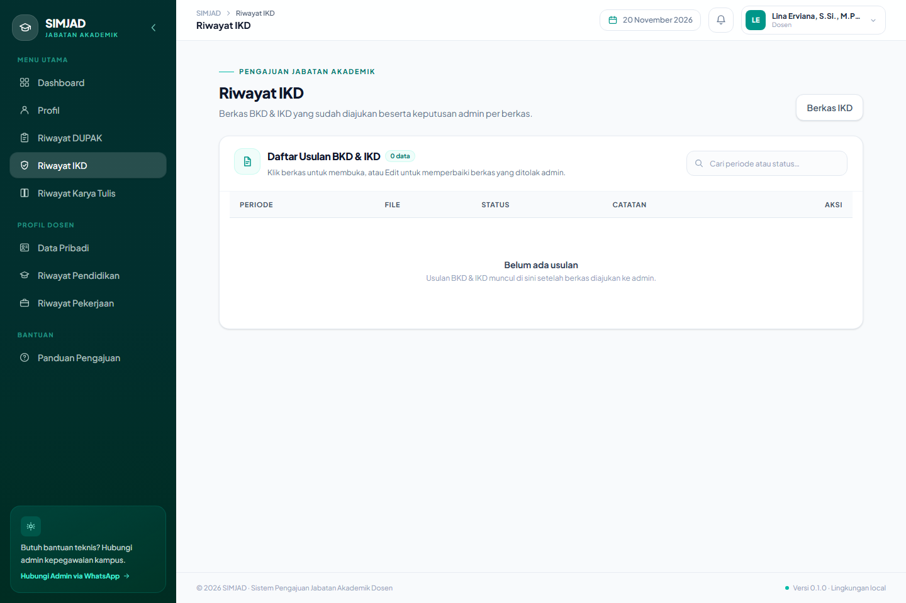

*Gambar 15. Riwayat IKD: tabel usulan BKD & IKD beserta status dan catatan admin.*

- Judul halaman **Riwayat IKD**, keterangan *"Berkas BKD & IKD yang sudah diajukan beserta
  keputusan admin per berkas."*
- Tombol **Berkas IKD** di kanan atas membuka halaman unggah (bagian 6.2).
- Kartu **Daftar Usulan BKD & IKD** menampilkan jumlah data, kotak **Cari periode atau
  status…**, dan kolom **Periode**, **File**, **Status**, **Catatan**, serta **Aksi**.
  Keterangan kartu: *"Klik berkas untuk membuka, atau Edit untuk memperbaiki berkas yang
  ditolak admin."*
- Bila belum ada data, tabel menampilkan **"Belum ada usulan"** dengan penjelasan *"Usulan BKD
  & IKD muncul di sini setelah berkas diajukan ke admin."*

Status yang mungkin muncul mengikuti keputusan admin: menunggu verifikasi, disetujui, atau
ditolak. Berkas berstatus ditolak dapat diperbaiki melalui tombol **Edit** yang mengarah
kembali ke formulir unggah.

---

# 7. Riwayat pengajuan dan panduan

## 7.1 Riwayat Pengajuan

Menu **Riwayat DUPAK** (judul halaman **Riwayat Pengajuan**) menampilkan *"Riwayat nilai PAK
tiap periode beserta hasil ajuan DUPAK Anda."* Tombol **+ Pengajuan Baru** di kanan atas
memulai usulan periode baru. Halaman ini memiliki dua tab.

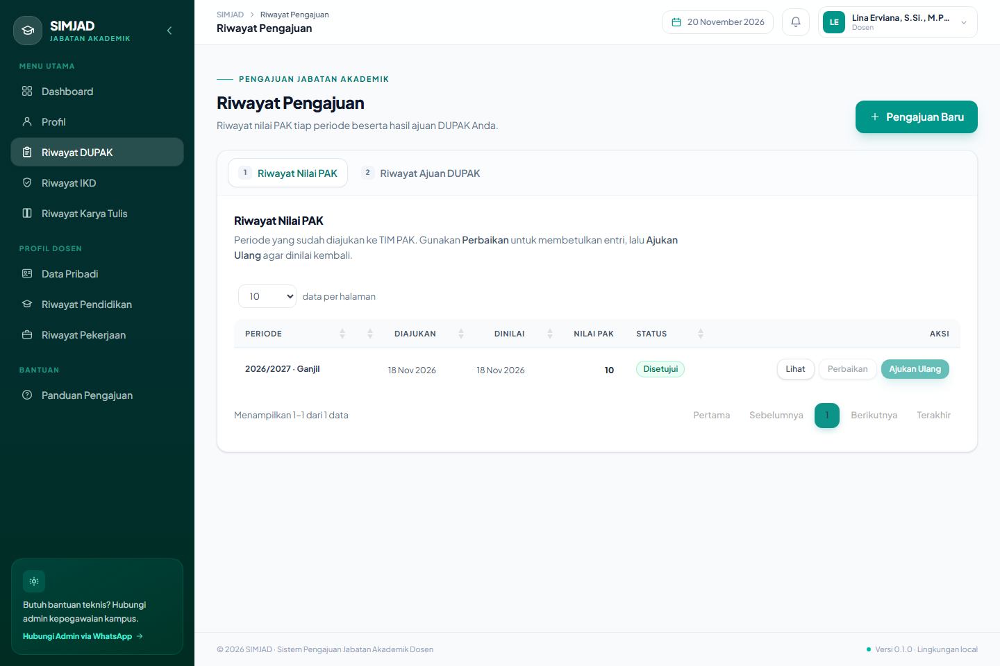

*Gambar 14. Riwayat Pengajuan: tab Riwayat Nilai PAK berisi periode yang sudah diajukan ke TIM PAK.*

### Tab 1 — Riwayat Nilai PAK

Keterangan tab: *"Periode yang sudah diajukan ke TIM PAK. Gunakan Perbaikan untuk membetulkan
entri, lalu Ajukan Ulang agar dinilai kembali."*

Kolom tabel: **Periode** (contoh *2026/2027 · Ganjil*), **Diajukan**, **Dinilai**, **Nilai
PAK**, **Status**, dan **Aksi**. Tiap kolom judul dapat diurutkan; pemilih **data per halaman**
mengatur jumlah baris; navigasi **Pertama / Sebelumnya / Berikutnya / Terakhir** tampil di bawah
tabel bersama keterangan *"Menampilkan 1–1 dari 1 data"*.

Arti tombol pada kolom **Aksi**:

| Tombol | Fungsi |
| --- | --- |
| **Lihat** | Membuka rekap nilai periode tersebut. Baru aktif setelah TIM PAK menyimpan nilai PAK. |
| **Perbaikan** | Membuka formulir pengajuan pada tab Review agar entri dapat dibetulkan. |
| **Ajukan Ulang** | Mengirim kembali periode ke TIM PAK. Muncul konfirmasi **Ajukan ulang nilai PAK?** dengan pesan *"Nilai PAK periode 2026/2027 · Ganjil akan diajukan ulang ke TIM PAK untuk dinilai kembali."* |

Bila belum ada data, tabel menampilkan **"Belum ada nilai PAK"**.

> **Catatan** — Pada periode yang sudah **Disetujui**, tombol **Perbaikan** dan **Ajukan Ulang**
> tidak aktif karena nilai sudah terkunci. Gunakan periode berikutnya untuk kegiatan baru.

### Tab 2 — Riwayat Ajuan DUPAK

Tab ini memuat DUPAK yang sudah diteruskan ke admin. Kolom: **Periode**, **Nilai PAK**,
**Dinilai**, **Hasil Pengajuan**, dan **Aksi**. Tombol **Lihat** membuka rekap DUPAK, sedangkan
**Cetak PDF** membuka versi cetak pada tab baru. Bila belum ada data, muncul **"Belum ada ajuan
DUPAK"**.

## 7.2 Panduan Pengajuan

Menu **Panduan Pengajuan** menyajikan petunjuk lengkap di dalam aplikasi, sehingga dosen tidak
perlu membuka dokumen terpisah.

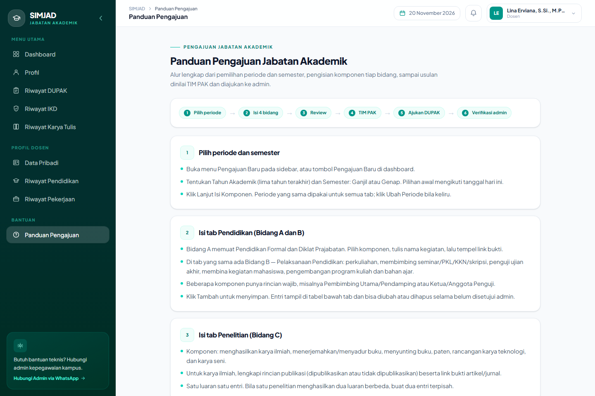

*Gambar 16. Panduan Pengajuan: diagram alur enam tahap dan langkah rinci per tahap.*

- Judul **Panduan Pengajuan Jabatan Akademik**, keterangan *"Alur lengkap dari pemilihan
  periode dan semester, pengisian komponen tiap bidang, sampai usulan dinilai TIM PAK dan
  diajukan ke admin."*
- Diagram alur di atas: **1 Pilih periode → 2 Isi 4 bidang → 3 Review → 4 TIM PAK → 5 Ajukan
  DUPAK → 6 Verifikasi admin**.
- Sembilan kartu langkah bernomor, dari **Pilih periode dan semester** sampai **Tindak lanjut
  hasil penilaian**, masing-masing berisi butir-butir petunjuk.
- Bagian **Arti status usulan** berupa tabel dua kolom (**Status**, **Keterangan**) yang
  menjelaskan ketujuh status usulan (lihat Bab 14).
- Bagian **Catatan penting** berisi empat butir, antara lain: link bukti wajib dapat dibuka
  tanpa login (*"siapa saja yang memiliki link"*), satu periode hanya punya satu usulan, entri
  masih bisa diubah selama DUPAK belum disetujui, dan periode yang sudah disetujui tidak bisa
  diajukan ulang.
- Dua tombol di bawah: **Mulai Pengajuan Baru** dan **Lihat Riwayat Pengajuan**.

---

# 8. Administrasi data dosen

Bab ini untuk pengguna dengan role **Admin**. Menu terkait berada pada kelompok **ADMINISTRASI** di
bilah samping: **Data Dosen** dan **Riwayat Dosen**.

## 8.1 Daftar data dosen

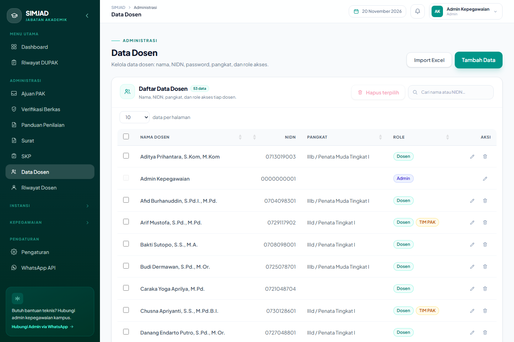

*Gambar 21. Data Dosen: 53 data, tombol Import Excel dan Tambah Data, kolom Nama Dosen, NIDN, Pangkat, Role, Aksi.*

- Judul **Data Dosen**, keterangan *"Kelola data dosen: nama, NIDN, password, pangkat, dan role
  akses."*
- Dua tombol kanan atas: **Import Excel** dan **Tambah Data**.
- Kartu **Daftar Data Dosen** menampilkan jumlah data (contoh *53 data*) serta keterangan
  *"Nama, NIDN, pangkat, dan role akses tiap dosen."*
- Kotak **Cari nama atau NIDN…** menyaring tabel; pemilih **data per halaman** mengatur jumlah
  baris; tiap judul kolom dapat diurutkan.
- Kolom: kotak centang, **Nama Dosen**, **NIDN**, **Pangkat**, **Role**, **Aksi**.
  - **Role** tampil sebagai lencana: **Dosen**, **TENDIK**, **TIM PAK**, atau **Admin**. Dosen
    yang juga anggota TIM PAK menampilkan dua lencana sekaligus (contoh: *Dosen* dan *TIM PAK*).
  - **Aksi** berisi ikon pensil (ubah) dan tempat sampah (hapus). Akun admin sendiri hanya
    memiliki ikon pensil.
- Kotak centang pada baris mengaktifkan tombol **Hapus terpilih** di kanan atas tabel untuk
  menghapus beberapa data sekaligus (dengan konfirmasi).
- Bila tabel kosong, muncul **"Belum ada data dosen."**

## 8.2 Menambah dan mengubah data dosen

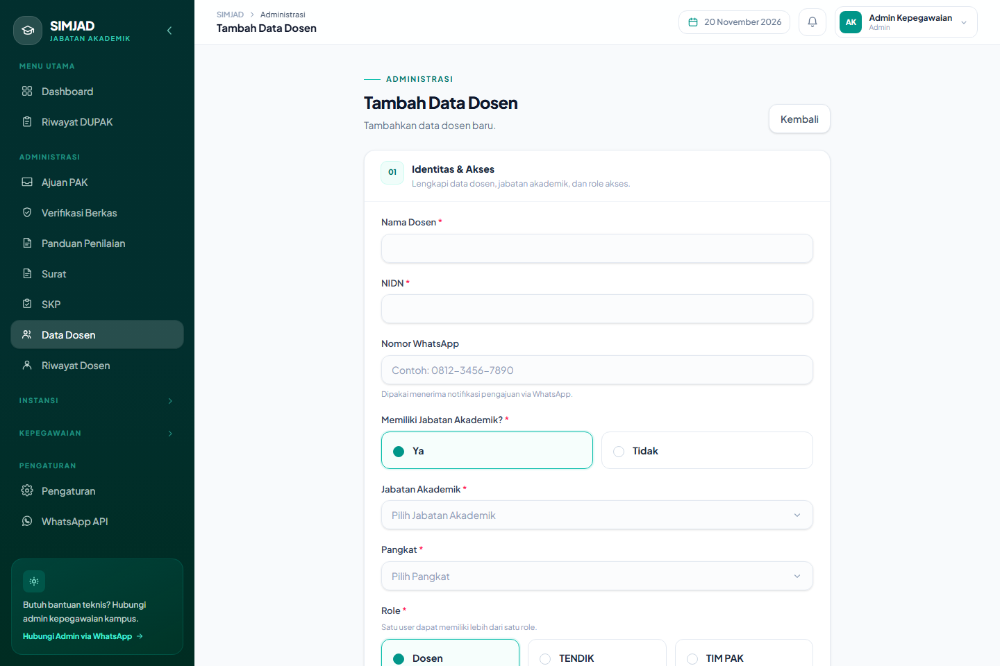

*Gambar 22. Formulir Tambah Data Dosen: bagian Identitas & Akses.*

1. Dari halaman Data Dosen, tekan **Tambah Data** (atau ikon pensil untuk mengubah).
2. Halaman **Tambah Data Dosen** / **Edit Data Dosen** terbuka. Pada mode ubah, **ID** akun
   ditampilkan di atas formulir, misalnya `#34`.
3. Lengkapi bagian **01 Identitas & Akses** — *"Lengkapi data dosen, jabatan akademik, dan role
   akses."*

| Isian | Wajib | Keterangan |
| --- | --- | --- |
| **Nama Dosen** | Ya | Nama lengkap beserta gelar, misalnya *Caraka Yoga Aprillya, M.Pd.* |
| **NIDN** | Ya | Nomor Induk Dosen Nasional. |
| **Nomor WhatsApp** | Tidak | Contoh format `0812-3456-7890`. Keterangan: *"Dipakai menerima notifikasi pengajuan via WhatsApp."* |
| **Memiliki Jabatan Akademik?** | Ya | Pilihan **Ya** atau **Tidak**. Memilih **Tidak** menonaktifkan dua isian di bawahnya — dipakai untuk dosen yang masih mengajukan jabatan pertama. |
| **Jabatan Akademik** | Ya (bila **Ya**) | Dropdown dengan pencarian *"Cari jabatan akademik…"*, misalnya *Asisten Ahli*, *Lektor*, *Lektor Kepala*, *Guru Besar*. |
| **Pangkat** | Ya (bila **Ya**) | Dropdown dengan pencarian *"Cari pangkat…"*, misalnya *III/b / Penata Muda Tingkat I*. |
| **Role** | Ya | Kotak centang **Dosen**, **TENDIK**, **TIM PAK**, **Admin**. Keterangan: *"Satu user dapat memiliki lebih dari satu role."* |
| **Password** | Ya saat tambah | Saat mengubah data, kosongkan bila password tidak ingin diganti. |
| **Konfirmasi Password** | Ya saat tambah | Harus sama dengan isian password. |

4. Tekan **Simpan Data** (atau **Simpan Perubahan** pada mode ubah), atau **Batal** untuk
   kembali tanpa menyimpan.
5. Bila ada isian bermasalah, muncul kotak *"Periksa kembali data Anda."* dengan jumlah isian
   yang perlu diperbaiki dan pesan merah di bawah isian terkait.

> **Peringatan** — NIDN harus unik. Bila NIDN sudah dipakai akun lain, penyimpanan ditolak.
> Periksa kembali daftar sebelum menambah data baru agar tidak terjadi duplikat.

## 8.3 Import data dosen dari Excel

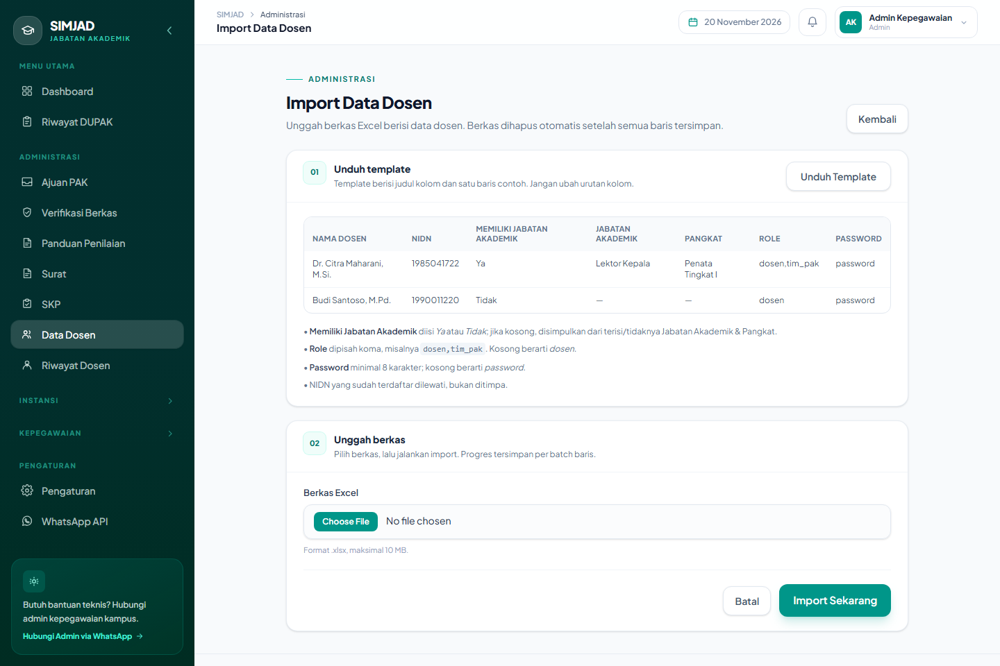

*Gambar 23. Import Data Dosen: unduh template, unggah berkas, dan progres per batch.*

1. Dari halaman Data Dosen, tekan **Import Excel**.
2. Halaman **Import Data Dosen** terbuka dengan keterangan *"Unggah berkas Excel berisi data
   dosen. Berkas dihapus otomatis setelah semua baris tersimpan."*
3. Pada bagian **Unduh template**, tekan **Unduh Template**. Keterangan: *"Template berisi judul
   kolom dan satu baris contoh. Jangan ubah urutan kolom."* Tabel pratinjau menampilkan judul
   kolom dan baris contoh.
4. Pada bagian **Unggah berkas**, pilih berkas **Berkas Excel** — *"Format .xlsx, maksimal 10
   MB."*
5. Jalankan import. Bilah progres menampilkan persentase dengan keterangan **Mengunggah
   berkas…** lalu proses penyimpanan. Keterangan halaman: *"Pilih berkas, lalu jalankan import.
   Progres tersimpan per batch baris."*
6. Bila gagal, muncul pesan seperti *"Sesi berakhir. Muat ulang halaman lalu ulangi."* atau
   *"Koneksi terputus saat mengunggah berkas."* Muat ulang halaman lalu ulangi. Tekan
   **Batal** atau **Kembali** untuk keluar.

> **Catatan** — Jangan menutup tab selama proses import berjalan. Import disimpan per batch,
> sehingga bila koneksi terputus cukup muat ulang halaman lalu jalankan ulang.

## 8.4 Riwayat dosen

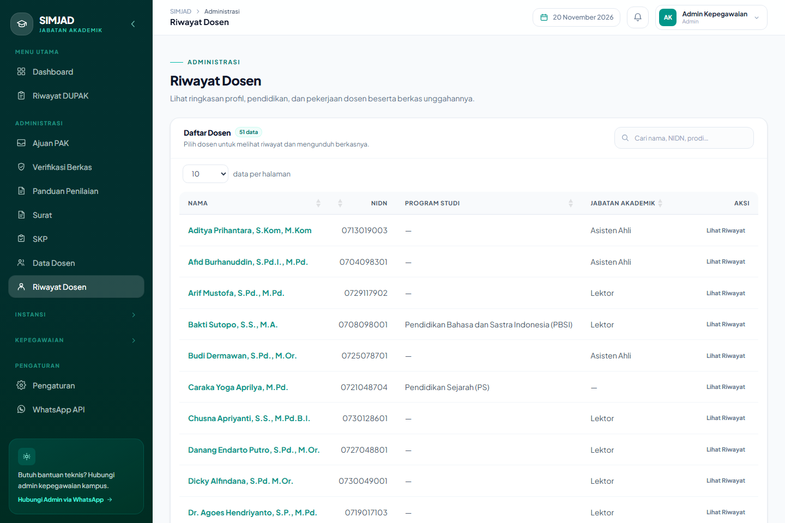

*Gambar 24. Riwayat Dosen: daftar dosen beserta NIDN, program studi, dan jabatan akademik.*

- Judul **Riwayat Dosen**, kotak **Cari dosen** dengan placeholder *"Cari nama, NIDN, prodi…"*.
- Kolom: **Nama**, **NIDN**, **Program Studi**, **Jabatan Akademik**, **Aksi**. Tombol pada
  kolom **Aksi** membuka detail riwayat dosen tersebut.
- Bila tabel kosong, muncul **"Belum ada data dosen."**

Klik salah satu baris untuk membuka halaman detail.

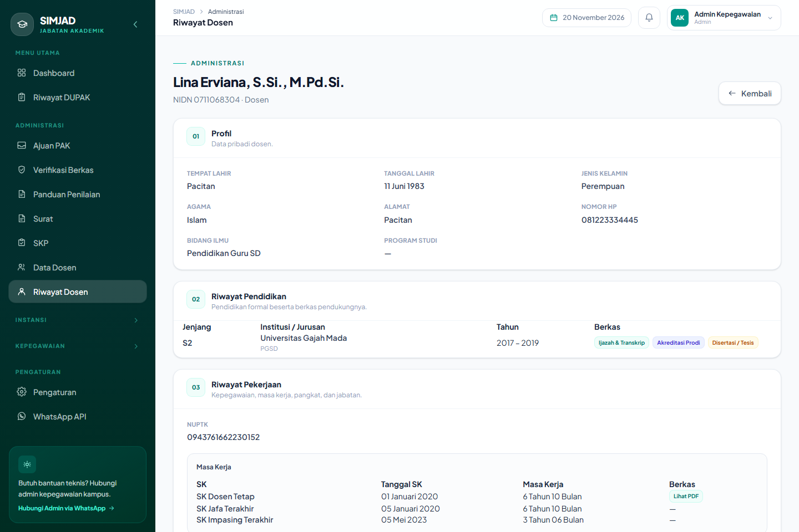

*Gambar 25. Detail Riwayat Dosen: profil, riwayat pendidikan, pekerjaan, dan angka kredit.*

Halaman detail menampilkan nama dosen sebagai judul, tombol **Profil**, lalu beberapa kartu:

| Bagian | Kolom | Bila kosong |
| --- | --- | --- |
| **Riwayat Pendidikan** | Jenjang, Institusi / Jurusan, Tahun, Berkas | **Belum ada riwayat pendidikan.** |
| **Riwayat Pekerjaan** | SK, Tanggal SK, Masa Kerja, Berkas | **Belum ada riwayat kepangkatan.** |
| Riwayat jabatan | — | **Belum ada riwayat jabatan.** |
| Riwayat angka kredit | — | **Belum ada riwayat angka kredit.** |

Kolom **Berkas** berisi tautan untuk membuka berkas pendukung milik dosen yang sedang dibuka,
bukan berkas pribadi admin.

---

# 9. Verifikasi dan penerusan ajuan

Tiga menu pada kelompok **ADMINISTRASI** menangani berkas yang masuk dari dosen:

| Menu | Isi yang ditangani |
| --- | --- |
| **Verifikasi Berkas** | Berkas BKD & IKD dosen tanpa jabatan akademik. |
| **Ajuan PAK** | Usulan nilai PAK yang perlu diteruskan ke anggota TIM PAK. |
| **Verifikasi DUPAK** (dibuka dari Ajuan PAK) | Keputusan akhir atas DUPAK: setujui, butuh perbaikan, atau tolak. |

## 9.1 Verifikasi Berkas Syarat Khusus

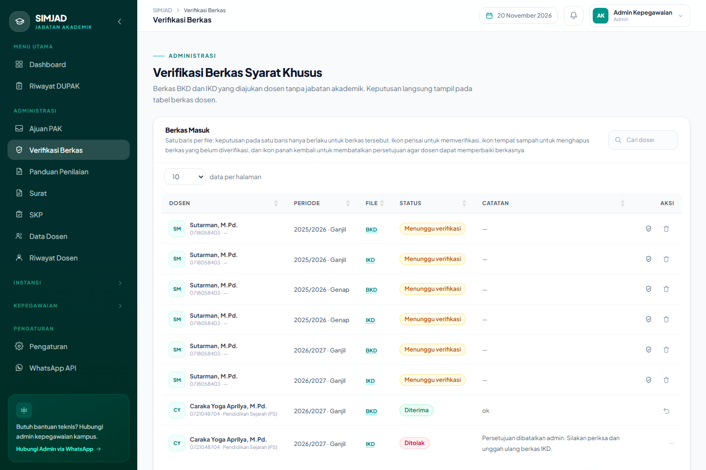

*Gambar 26. Verifikasi Berkas Syarat Khusus: satu baris per berkas dengan status dan aksi per baris.*

Keterangan halaman: *"Berkas BKD dan IKD yang diajukan dosen tanpa jabatan akademik. Keputusan
langsung tampil pada tabel berkas dosen."*

Kartu **Berkas Masuk** menjelaskan aturan kerja:

- *"Satu baris per file; keputusan pada satu baris hanya berlaku untuk berkas tersebut."* Artinya
  berkas **BKD** dan **IKD** diverifikasi terpisah, meskipun periodenya sama.
- *"Ikon perisai untuk memverifikasi, ikon tempat sampah untuk menghapus berkas yang belum
  diverifikasi, dan ikon panah kembali untuk membatalkan persetujuan agar dosen dapat
  memperbaiki berkasnya."*

Kolom tabel: **Dosen** (nama dan NIDN beserta program studi), **Periode**, **File** (lencana
**BKD** atau **IKD**), **Status**, **Catatan**, **Aksi**.

Status yang tampil: **Menunggu verifikasi** (kuning), **Diterima** (hijau), **Ditolak** (merah).
Catatan berisi tanda *—* bila kosong, atau teks dari admin, misalnya *"Persetujuan dibatalkan
admin. Silakan periksa dan unggah ulang berkas IKD."*

Langkah memverifikasi satu berkas:

1. Gunakan **Cari berkas** (placeholder *"Cari dosen, periode…"*) atau pemilih **data per
   halaman** untuk menemukan baris yang dituju.
2. Tekan ikon **perisai** pada kolom **Aksi**. Panel **Keputusan** terbuka di bawah baris
   tersebut.
3. Pilih **Diterima** atau **Ditolak** dan isi catatan bila perlu.
4. Simpan. Status pada baris berubah dan keputusan langsung terlihat oleh dosen pada halaman
   Indikator Kinerja Dosen.

Ikon lain pada kolom **Aksi**:

- **Tempat sampah** — menghapus berkas yang belum diverifikasi.
- **Panah kembali** — membatalkan persetujuan; dipakai ketika dosen perlu memperbaiki berkas.
  Setelah dibatalkan, dosen dapat mengunggah ulang dan mengajukan kembali.

Bila belum ada berkas yang masuk, tabel menampilkan **"Belum ada berkas masuk"**.

## 9.2 Ajuan PAK: meneruskan usulan ke TIM PAK

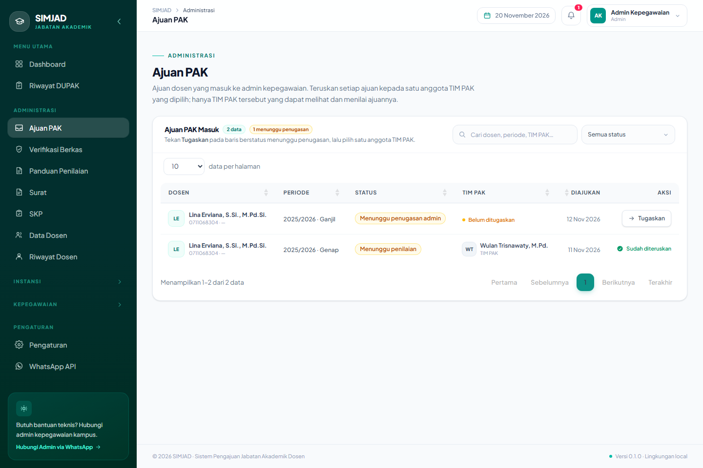

*Gambar 27. Ajuan PAK: dua data masuk, satu menunggu penugasan, satu sudah diteruskan.*

Keterangan halaman: *"Ajuan dosen yang masuk ke admin kepegawaian. Teruskan setiap ajuan kepada
satu anggota TIM PAK yang dipilih; hanya TIM PAK tersebut yang dapat melihat dan menilai
ajuannya."*

- Kartu **Ajuan PAK Masuk** menampilkan jumlah data dan lencana jumlah yang **menunggu
  penugasan**, contoh *2 data* dan *1 menunggu penugasan*. Petunjuk: *"Tekan Tugaskan pada baris
  berstatus menunggu penugasan, lalu pilih satu anggota TIM PAK."*
- Dua penyaring di kanan: **Cari ajuan PAK** (placeholder *"Cari dosen, periode, TIM PAK…"*) dan
  **Filter status ajuan PAK** dengan pilihan **Semua status**, **Menunggu penugasan admin**,
  **Menunggu penilaian**, dan **Sudah dinilai**.
- Kolom: **Dosen** (nama dan NIDN), **Periode**, **Status**, **TIM PAK**, **Diajukan**, **Aksi**.

Langkah meneruskan ajuan:

1. Cari baris berstatus **Menunggu penugasan admin**.
2. Tekan **→ Tugaskan** pada kolom **Aksi**. Panel penugasan terbuka.
3. Pilih **Anggota TIM PAK** \* dari dropdown **Pilih TIM PAK** (pencarian *"Cari nama TIM
   PAK…"*). Bila belum ada anggota aktif, muncul pesan *"Belum ada pengguna TIM PAK aktif.
   Tambahkan peran TIM PAK pada menu Data Dosen."*
4. Tekan **Teruskan ke TIM PAK**. Peringatan pada panel: *"Setelah diteruskan, hanya TIM PAK yang
   dipilih yang dapat melihat dan menilai ajuan ini."*
5. Status berubah menjadi **Menunggu penilaian**; kolom **TIM PAK** menampilkan nama penilai
   beserta lencana **TIM PAK**, dan kolom **Aksi** menampilkan **Sudah diteruskan**.

> **Peringatan** — Penugasan bersifat mengikat. Bila penugasan gagal diproses, muncul pesan
> **"Penugasan TIM PAK gagal diproses."** Periksa apakah anggota TIM PAK masih aktif, lalu ulangi.

Bila belum ada ajuan, tabel menampilkan **"Belum ada ajuan PAK"** dengan penjelasan *"Ajuan dosen
akan tampil di sini setelah dikirim ke TIM PAK."*

## 9.3 Verifikasi DUPAK

Halaman ini dibuka ketika admin memeriksa DUPAK yang sudah diajukan dosen (status **Diajukan
DUPAK**).

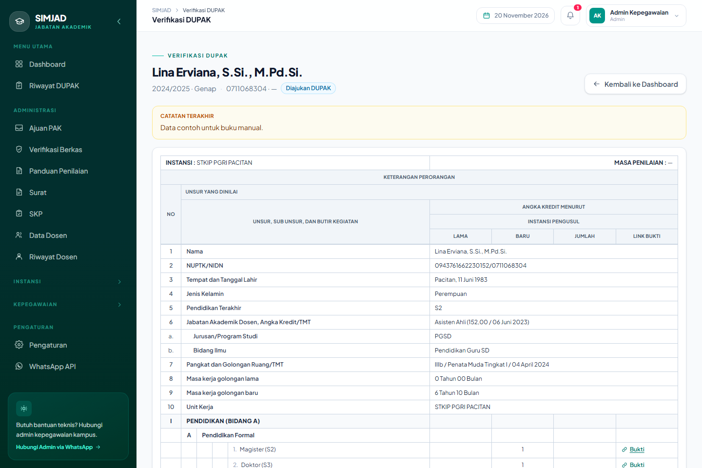

*Gambar 28. Verifikasi DUPAK: identitas dosen, rekap DUPAK lengkap, dan panel Keputusan Verifikasi.*

Bagian atas halaman:

- Judul berupa nama dosen (contoh *Lina Erviana, S.Si., M.Pd.Si.*), di bawahnya periode
  (*2024/2025 · Genap*), NIDN, program studi, dan lencana status **Diajukan DUPAK**.
- Tombol **← Kembali ke Dashboard** di kanan atas.
- Kotak **CATATAN TERAKHIR** berisi catatan admin sebelumnya, bila ada.

Rekap DUPAK ditampilkan persis seperti dokumen resmi, dengan kolom tabel sembilan lajur:

1. Baris kepala: **INSTANSI : <nama perguruan tinggi>** dan **MASA PENILAIAN : <rentang>**
   (tertulis *—* bila dosen belum mengisi).
2. **KETERANGAN PERORANGAN** dengan sepuluh butir bernomor: 1 Nama, 2 NUPTK/NIDN, 3 Tempat dan
   Tanggal Lahir, 4 Jenis Kelamin, 5 Pendidikan Terakhir, 6 Jabatan Akademik Dosen, Angka
   Kredit/TMT (dengan sub-butir a. Jurusan/Program Studi dan b. Bidang Ilmu), 7 Pangkat dan
   Golongan Ruang/TMT, 8 Masa kerja golongan lama, 9 Masa kerja golongan baru, 10 Unit Kerja.
3. Unsur yang dinilai per bidang — **PENDIDIKAN (BIDANG A)** dan seterusnya — dengan sub-unsur,
   butir kegiatan, angka kredit **LAMA**, **BARU**, **JUMLAH**, serta tombol **Bukti** pada
   kolom **LINK BUKTI**.
4. Baris pengesahan di bagian bawah rekap.

Panel **Keputusan Verifikasi** di bawah rekap berisi petunjuk *"Pilih satu keputusan, isi alasan
bila diperlukan, lalu tekan Simpan."*

| Keputusan | Deskripsi pada layar | Konsekuensi |
| --- | --- | --- |
| **Setujui** | *"DUPAK diterima dan lanjut ke penetapan angka kredit."* | Status **Disetujui**; nilai PAK terkunci dan DUPAK siap dicetak dosen. |
| **Butuh Perbaikan** | *"Dikembalikan ke dosen dengan catatan perbaikan."* | Status **Butuh Perbaikan**; dosen membetulkan entri lalu mengajukan ulang. |
| **Tolak** | *"DUPAK tidak dapat diproses."* | Status **Ditolak**; usulan dihentikan. |

Isian pada panel:

- **Nomor Surat Keputusan** \* — wajib saat memilih **Setujui**. Contoh format pada kolom:
  `001/SK/PAK/2026`. Panjang maksimal 150 karakter.
- **Masa Penilaian** — menampilkan rentang yang diisi dosen, atau **"Belum diisi dosen"**.
  Keterangan: *"Sesuai masukan dosen saat mengusulkan DUPAK."*
- **Alasan / catatan untuk dosen** — placeholder *"Tuliskan alasan perbaikan atau penolakan..."*.
  Wajib diisi saat memilih **Butuh Perbaikan** atau **Tolak**.
- Tekan **Simpan**. Konfirmasi **Simpan keputusan?** mengingatkan bahwa *"Keputusan verifikasi
  akan disimpan dan langsung terlihat oleh dosen."*

Keterangan penutup: *"Keputusan langsung tampil pada halaman Riwayat Pengajuan dosen."*

> **Peringatan** — Keputusan **Setujui** mengunci nilai PAK: TIM PAK tidak dapat menilai ulang dan
> dosen tidak dapat mengajukan ulang periode tersebut. Pastikan nomor SK sudah benar sebelum
> menyimpan.

---

# 10. Ruang Admin — surat, SKP, dan data kepegawaian

## 10.1 Surat: dokumen kelengkapan usulan

Menu **Surat** pada kelompok **ADMINISTRASI** memuat semua dokumen surat kelengkapan usulan
jabatan akademik. Keterangan halaman: *"Dokumen surat kelengkapan usulan jabatan akademik
dosen."*

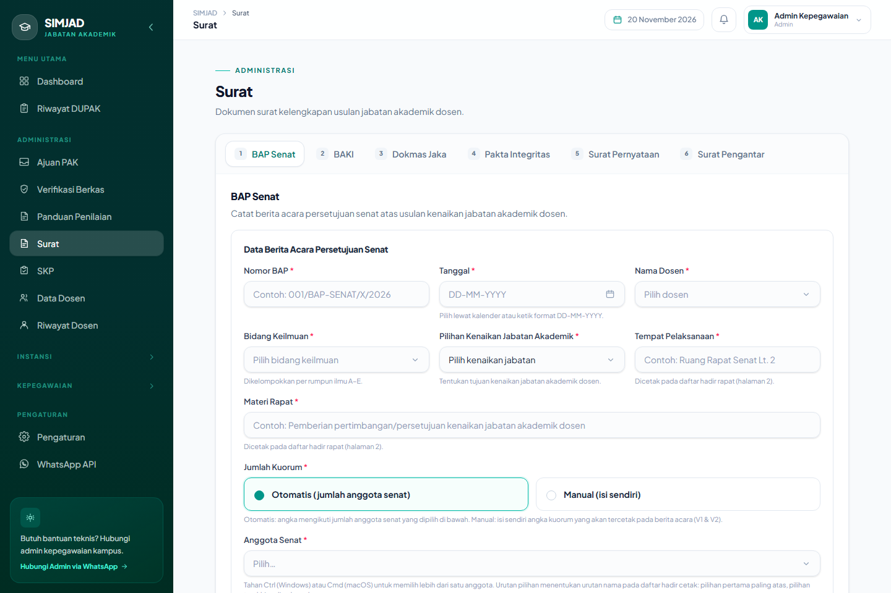

*Gambar 29. Halaman Surat: enam tab jenis surat, formulir BAP Senat terbuka.*

Enam tab dari kiri ke kanan:

| Tab | Isi |
| --- | --- |
| **1 BAP Senat** | Berita Acara Persetujuan Senat atas usulan kenaikan jabatan akademik dosen. |
| **2 BAKI** | Berita Acara Komite Integritas Akademik. |
| **3 Dokmas Jaka** | Dokumen Formasi Jabatan Akademik Dosen. Tab ini masih menampilkan **Belum ada isi**. |
| **4 Pakta Integritas** | Pernyataan pakta integritas beserta lembar validasi karya ilmiah. |
| **5 Surat Pernyataan** | Surat pernyataan pimpinan untuk dosen yang diusulkan. |
| **6 Surat Pengantar** | Surat pengantar usulan, perorangan atau kolektif. |

Setiap tab memakai pola yang sama: formulir di atas (**Simpan** / **Perbarui**), lalu kartu daftar
berisi surat yang sudah tersimpan dengan keterangan *"… terbaru di atas"*, kotak pencarian, dan
tombol **Cetak** per baris. Bila ada isian bermasalah, muncul pesan *"Terdapat N isian yang perlu
diperbaiki sebelum … dapat disimpan."*

### BAP Senat

Bagian **Data Berita Acara Persetujuan Senat**:

- **Nomor BAP** \* — contoh format `001/BAP-SENAT/X/2026`.
- **Tanggal** \* — format `DD-MM-YYYY`; dapat dipilih lewat kalender atau diketik.
- **Nama Dosen** \* — dropdown **Pilih dosen**.
- **Bidang Keilmuan** \* — dropdown **Pilih bidang keilmuan**, dikelompokkan per rumpun ilmu A–F:
  A. Komputer & Teknologi, B. Bahasa & Linguistik, C. Pendidikan & Keguruan, D. Humaniora, Sosial &
  Keagamaan, E. Ekonomi, dan F. IPA (Pendidikan IPA, Pendidikan Sains, Pendidikan Biologi).
- **Pilihan Kenaikan Jabatan Akademik** \* — tujuan kenaikan, misalnya *Lektor* atau *Lektor
  Kepala*.
- **Tempat Pelaksanaan** \* — contoh *Ruang Rapat Senat Lt. 2*. Dicetak pada daftar hadir rapat
  (halaman 2).
- **Materi Rapat** \* — contoh *Pemberian pertimbangan/persetujuan kenaikan jabatan akademik
  dosen*.
- **Jumlah Kuorum** \* — dua pilihan: **Otomatis (jumlah anggota senat)** atau **Manual (isi
  sendiri)**. Pada mode manual, isi **Jumlah Kuorum Manual** (contoh `12`). Angka ini tercetak
  pada kalimat *"yang dihadiri oleh sejumlah … orang anggota senat"*.
- **Anggota Senat** \* — pilih beberapa anggota dengan menahan `Ctrl` (Windows) atau `Cmd`
  (macOS). Keterangan pada layar: *"Urutan pilihan menentukan urutan nama pada daftar hadir
  cetak: pilihan pertama paling atas, pilihan …"*

Tombol **Simpan** menyimpan BAP; **Perbarui** muncul saat menyunting. Daftar **Berita Acara
Persetujuan Senat** memiliki pencarian *"Cari nomor atau dosen…"* dan tombol **Cetak** untuk
membuka PDF BAP.

### BAKI

Bagian **Data Berita Acara Komite Integritas Akademik**:

- **Nomor Surat** \* — contoh `001/BAKI/X/2026`.
- **Tanggal** \* — format `DD-MM-YYYY`.
- **Tempat Pelaksanaan** — contoh *Ruang Rapat Tim Komite Lt. 2*, dicetak pada daftar hadir
  rapat halaman 2.
- Pilihan dosen yang dibahas serta tombol **Simpan** / **Perbarui**.

Daftar **BAKI** menyediakan pencarian *"Cari nomor atau dosen…"* dan tombol **Cetak**.

### Pakta Integritas

Formulir memuat **Tanggal Pakta** (format `DD-MM-YYYY`) serta bagian validasi:

- **Nomor Validasi Surat** — contoh `750/STKIP PGRI PACITAN/KL/TX/2025`. Keterangan: *"Dipakai
  sebagai nomor pada lembar validasi karya ilmiah (opsional)."*
- **Tanggal Pengesahan Validasi** — dicetak sebagai *"<Kota>, tanggal"* pada lembar validasi;
  kosong berarti memakai tanggal pakta.
- Daftar karya ilmiah dosen yang dapat dicentang. Keterangan: *"Karya yang dicentang akan dicetak
  pada tabel surat. Tanpa centang berarti semua karya ilmiah dosen dicetak."* Bila dosen belum
  punya karya, muncul **"Belum ada karya ilmiah yang terdaftar untuk dosen ini."**
- Tombol **Simpan** / **Perbarui**. Pada daftar **Pakta Integritas**, tombol **Cetak** membuka
  dialog pilihan jenis cetak: **Pernyataan** atau **Validasi**.

### Surat Pernyataan

Keterangan: *"Catat surat pernyataan pimpinan untuk dosen yang diusulkan beserta tanggal
suratnya."* Isian:

| Isian | Keterangan |
| --- | --- |
| **Nama Pimpinan** \* | Dropdown **Pilih pimpinan** dengan pencarian *"Cari nama pimpinan…"*. Tiap pilihan tampil sebagai *Nama — Jabatan Struktural*. Bila kosong, muncul **"Belum ada pejabat struktural."** dengan tautan untuk menambahkannya lebih dulu. |
| **Dosen Yang Di Usulkan** \* | Dropdown **Pilih dosen** dengan pencarian *"Cari nama dosen…"*; tiap pilihan tampil sebagai *Nama — NIDN*. |
| **Tanggal Surat** \* | Format `DD-MM-YYYY`. |

Daftar **Pernyataan Pimpinan** menampilkan surat tersimpan sebagai **No. <nomor surat>** dengan
tombol **Cetak** dan **Ubah**. Bila belum ada, muncul petunjuk *"Isi formulir di atas untuk
menambahkan surat pertama."*

### Surat Pengantar

Keterangan: *"Surat pengantar usulan jabatan akademik dosen — perorangan (satu dosen) atau
kolektif (beberapa dosen)."*

- **Bentuk surat** — pilih **Perorangan** (*"Surat memuat satu dosen (dipilih dari daftar
  nama)."*) atau **Kolektif** (*"Surat memuat lebih dari satu dosen (dipilih dari beberapa nama,
  dicetak sebagai tabel)."*).
- **Nomor Surat** \* — contoh `613/STKIP PGRI/KP/III/2026`.
- **Tanggal Surat** \* — format `DD-MM-YYYY`.
- **Lampiran** — contoh `1 berkas`.
- **Perihal** — contoh *Usulan Jabatan Akademik*.
- **Tujuan Surat (Yth.)** — contoh *Kepala LLDIKTI Wilayah VII Jawa Timur*. Keterangan: *"Dicetak
  pada baris pertama: 'Kepada. Yth. …'."*
- **Kota Tujuan Surat** — contoh *Surabaya*. Keterangan: *"Dicetak pada baris ketiga, di bawah
  'di'."*
- **Nama Dosen** \* — pada mode perorangan berupa dropdown **Pilih dosen**; pada mode kolektif
  berupa pilihan banyak dosen.
- **Diusulkan ke** — hanya pada mode perorangan: jabatan akademik yang diusulkan, dicetak sebagai
  baris **"Diusulkan"** pada PDF.

Daftar **Surat Pengantar** memiliki pencarian *"Cari nama atau nomor surat…"* dan tombol **Cetak**
untuk membuka PDF surat.

## 10.2 SKP: Sasaran Kinerja Pegawai

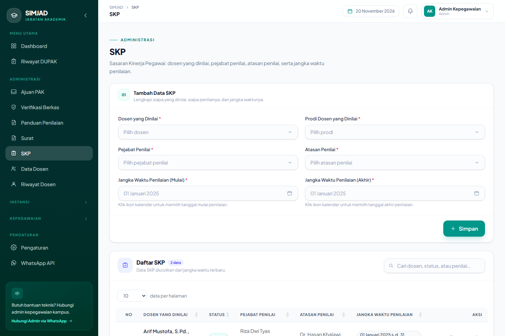

*Gambar 30. Halaman SKP: formulir Tambah Data SKP di atas dan Daftar SKP di bawah.*

Keterangan halaman: *"Sasaran Kinerja Pegawai: dosen yang dinilai, pejabat penilai, atasan
penilai, serta jangka waktu penilaian."*

Bagian **01 Tambah Data SKP** — *"Lengkapi siapa yang dinilai, siapa penilainya, dan jangka
waktunya."* Enam isian wajib, tersusun dua kolom:

| Isian | Pilihan |
| --- | --- |
| **Dosen yang Dinilai** \* | Dropdown **Pilih dosen**. |
| **Prodi Dosen yang Dinilai** \* | Dropdown **Pilih prodi**. |
| **Pejabat Penilai** \* | Dropdown **Pilih pejabat penilai**. |
| **Atasan Penilai** \* | Dropdown **Pilih atasan penilai**. |
| **Jangka Waktu Penilaian (Mulai)** \* | Tanggal awal; keterangan *"Klik ikon kalender untuk memilih tanggal mulai penilaian."* |
| **Jangka Waktu Penilaian (Akhir)** \* | Tanggal akhir; keterangan *"Klik ikon kalender untuk memilih tanggal akhir penilaian."* |

Tekan **+ Simpan**. Bila menyunting data yang sudah ada, tombol berubah menjadi **Simpan
Perubahan** dan tersedia **Batal**.

Kartu **Daftar SKP** menampilkan jumlah data dan keterangan *"Data SKP diurutkan dari jangka waktu
terbaru."* Kotak pencarian berplaceholder *"Cari dosen, status, atau penilai…"*. Kolom: **No**,
**Dosen yang Dinilai**, **Status**, **Pejabat Penilai**, **Atasan Penilai**, **Jangka Waktu
Penilaian**, **Aksi** (ikon cetak, ubah, dan hapus). Bila kosong, muncul **"Belum ada data SKP"**.

Tombol cetak membuka dua jenis berkas: halaman cetak SKP (`skp.cetak`) dan versi cetak dengan
parameter `print`, keduanya pada tab baru.

> **Catatan** — SKP menjadi dasar penilaian perilaku kerja dosen dan dapat disanggah lewat
> keberatan SKP (Bab 13). Pastikan pejabat penilai dan atasan penilai sudah benar sebelum
> menyimpan, karena keduanya menentukan siapa yang berhak menilai.

## 10.3 Data kepegawaian: jabatan dan kepangkatan

Kelompok menu **KEPEGAWAIAN** pada sidebar berisi tiga data master yang dipakai sebagai pilihan
dropdown di seluruh aplikasi:

| Menu | Keterangan halaman | Contoh isi |
| --- | --- | --- |
| **Jabatan Akademik** | *"Kelola daftar jabatan akademik dosen (mis. Asisten Ahli, Lektor, Lektor Kepala)."* | Asisten Ahli, Lektor, Lektor Kepala, Guru Besar |
| **Jabatan Struktural** | *"Kelola daftar jabatan struktural pada lingkungan perguruan tinggi."* | Kepala Biro, Kepala Lembaga, Kepala UPT |
| **Kepangkatan** | *"Kelola daftar pangkat dan golongan kepegawaian dosen."* | Penata Tingkat I — `III/d` |

### Jabatan Akademik

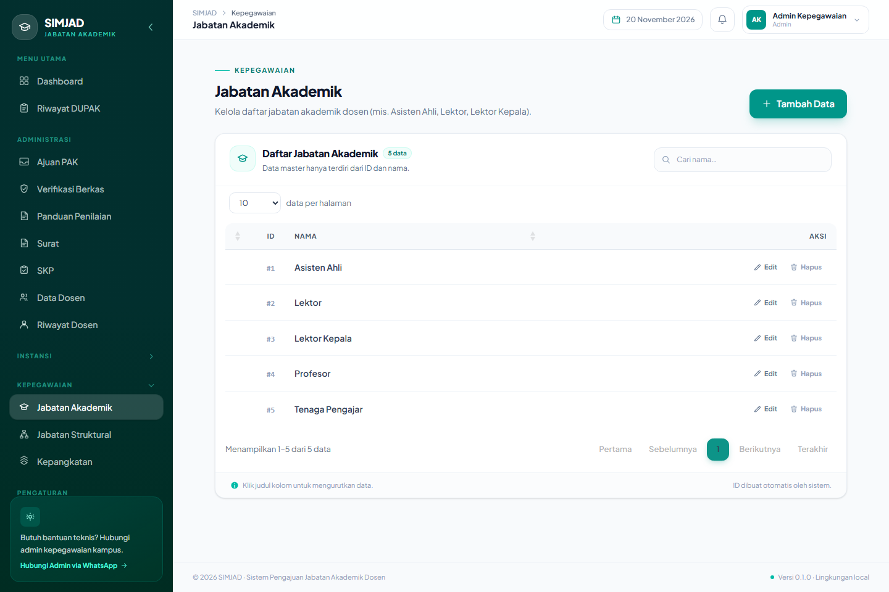

*Gambar 31. Daftar Jabatan Akademik beserta jumlah data, pencarian, dan aksi Edit/Hapus.*

Kartu **Daftar Jabatan Akademik** menampilkan lencana jumlah data (contoh *4 data*) dan keterangan
*"Data master hanya terdiri dari ID dan nama."* Tabel memuat kolom **ID**, **NAMA**, dan **AKSI**.
Klik judul kolom **ID** atau **NAMA** untuk mengurutkan; tanda panah kecil menunjukkan kolom yang
sedang dipakai.

Langkah menambah data:

1. Tekan **+ Tambah Data** di kanan atas.
2. Isi **Nama** — placeholder `Contoh: Lektor Kepala`, maksimal 100 karakter.
3. Tekan **Simpan Data**.

Langkah mengubah: tekan **Edit** pada baris yang dituju, ubah **Nama**, lalu tekan **Simpan
Perubahan**. Tombol **Batal** membatalkan tanpa menyimpan. Keterangan pada formulir: *"Perubahan
langsung tersimpan setelah tombol ditekan."*

Langkah menghapus: tekan **Hapus**, lalu setujui pertanyaan konfirmasi *"Hapus data Jabatan
Akademik '<nama>'? Tindakan ini tidak dapat dibatalkan."*

Kotak pencarian berplaceholder *"Cari nama…"* menyaring tabel seketika; tombol **×** di dalamnya
membersihkan pencarian. Pilihan **10 / 25 / 50 / 100** di atas tabel mengatur jumlah baris per
halaman.

### Jabatan Struktural

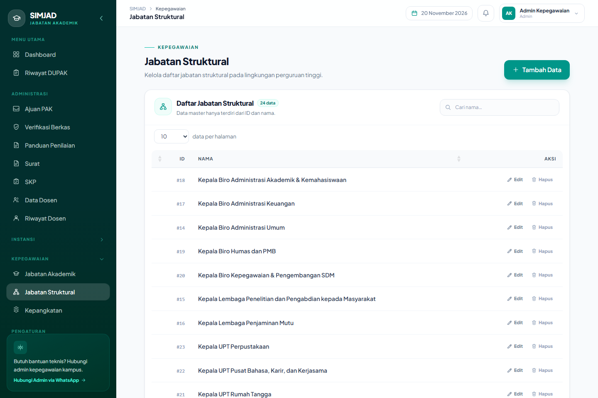

*Gambar 32. Daftar Jabatan Struktural dengan 24 data contoh.*

Tampilan dan langkah kerjanya sama dengan Jabatan Akademik: kartu **Daftar Jabatan Struktural**,
pencarian *"Cari nama…"*, kolom **ID**, **NAMA**, **AKSI**, serta tombol **+ Tambah Data**.
Bedanya hanya isi: jabatan struktural adalah jabatan di lingkungan perguruan tinggi, misalnya
*Kepala Biro Administrasi Akademik & Kemahasiswaan* atau *Kepala UPT Perpustakaan*.

Daftar ini dipakai oleh menu **Surat** (pilihan **Nama Pimpinan** pada Surat Pernyataan) dan oleh
menu **Pejabat Struktural** (Bab 11). Karena itu, tambahkan jabatan struktural lebih dulu sebelum
mengisi surat pernyataan pimpinan.

### Kepangkatan

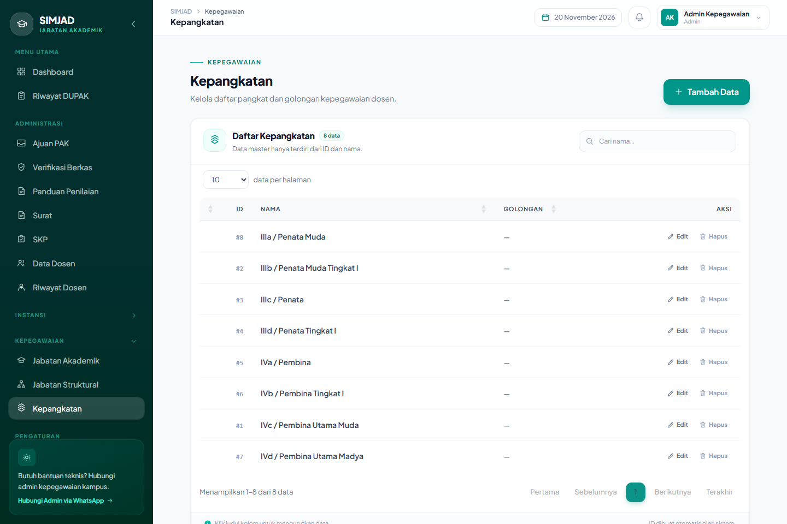

*Gambar 33. Daftar Kepangkatan: kolom tambahan Golongan di antara Nama dan Aksi.*

Kepangkatan memiliki satu kolom tambahan: **Golongan**. Pada formulir, selain **Nama** (placeholder
`Contoh: Penata Tingkat I`) terdapat isian **Golongan Ruang** dengan placeholder `Contoh: IIIa`,
maksimal 20 karakter. Bila golongan dikosongkan, tabel menampilkan tanda `—`.

Langkah kerjanya tetap sama: **+ Tambah Data** → isi **Nama** dan **Golongan Ruang** → **Simpan
Data**; **Edit** → **Simpan Perubahan**; **Hapus** → setujui konfirmasi.

> **Peringatan** — ketiga data master ini dipakai sebagai rujukan di banyak tempat (profil dosen,
> SKP, surat, dan usulan jabatan). Menghapus satu baris dapat membuat data lama kehilangan
> rujukan. Ubah nama terlebih dahulu bila hanya ingin membetulkan ejaan.

---

# 11. Ruang Admin — data instansi dan pengaturan sistem

## 11.1 Data Instansi

Menu **Instansi → Data Instansi**. Keterangan halaman: *"Lengkapi identitas instansi yang akan
digunakan pada dokumen dan pengajuan jabatan akademik."*

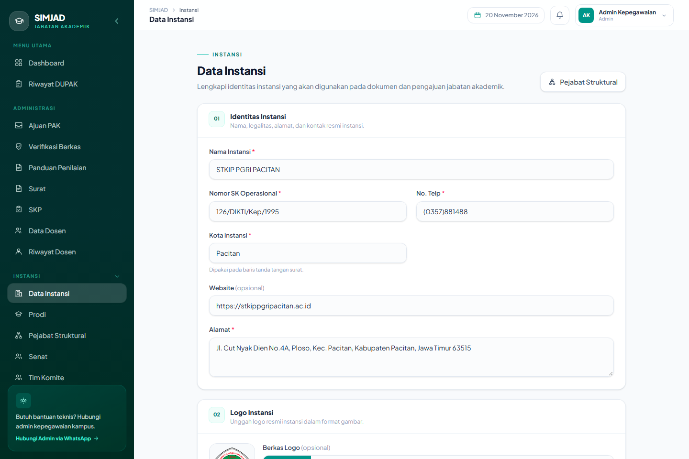

*Gambar 34. Data Instansi: bagian 01 Identitas Instansi dan awal bagian 02 Logo Instansi.*

Formulir dibagi menjadi beberapa bagian bernomor. Setiap bagian diakhiri tombol simpan tersendiri.

### 01 Identitas Instansi

*"Nama, legalitas, alamat, dan kontak resmi instansi."*

| Isian | Placeholder / keterangan |
| --- | --- |
| **Nama Instansi** \* | `Contoh: Universitas Athena Nusantara` |
| **Nomor SK Operasional** \* | `Contoh: SK-MENDIKBUD/001/2026` |
| **No. Telp** \* | `Contoh: (022) 1234567` |
| **Kota Instansi** \* | `Contoh: Bandung` — *"Dipakai pada baris tanda tangan surat."* |
| **Website** (opsional) | `Contoh: https://athena.ac.id` |
| **Alamat** \* | `Alamat lengkap instansi` |

### 02 Logo Instansi

*"Unggah logo resmi instansi dalam format gambar."* Bila logo sudah ada, muncul keterangan
*"Unggah berkas baru untuk mengganti logo saat ini."* Logo ini tercetak pada kop surat dan berita
acara.

### Bagian LLDIKTI

Tiga isian opsional: **Wilayah LLDIKTI** (`Contoh: VII`), **Nama Pimpinan**
(`Contoh: Prof. Dr. Dyah Sawitri, S.E., M.M.`), dan **NIP Pimpinan**
(`Contoh: 196704192005012001`). Ketiganya dipakai pada bagian tanda tangan dokumen.

Tekan **Simpan Data Instansi** di bagian bawah. Bila ada isian bermasalah, muncul pesan
*"Terdapat N isian yang perlu diperbaiki sebelum data dapat disimpan."* Tombol **Pejabat
Struktural** di kanan atas membuka menu 11.3.

> **Catatan** — Nama instansi, kota, dan logo dipakai berulang pada kop semua surat dan BAP. Isi
> bagian ini sebelum membuat surat pertama.

## 11.2 Prodi

Menu **Instansi → Prodi**. Keterangan halaman: *"Kelola daftar program studi beserta kode
singkatannya, misalnya Prodi Bahasa Indonesia dengan kode PBI."*

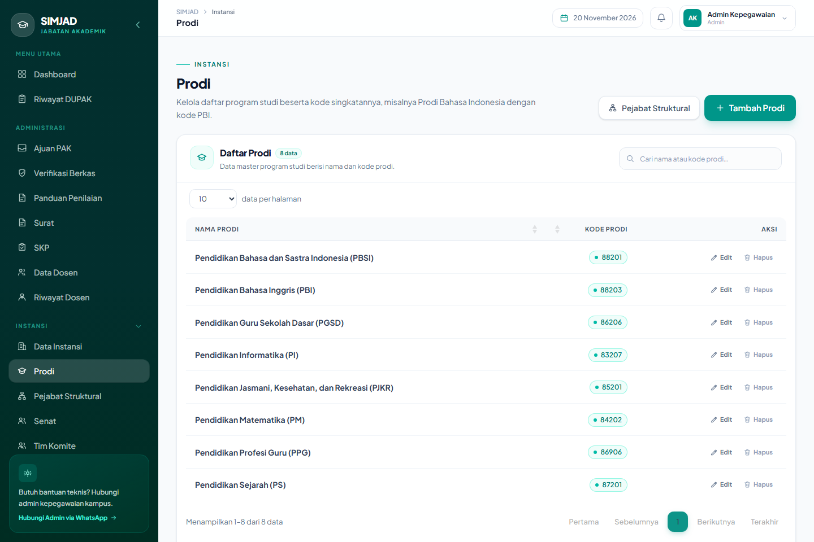

*Gambar 38. Daftar Prodi: delapan data contoh, kolom Nama Prodi, Kode Prodi, dan Aksi.*

Kartu **Daftar Prodi** menampilkan lencana jumlah data dan keterangan *"Data master program studi
berisi nama dan kode prodi."* Kolom tabel: **NAMA PRODI**, **KODE PRODI**, **AKSI**. Kode prodi
tampil sebagai lencana kecil (contoh `88201`, `PBI`). Kotak pencarian berplaceholder *"Cari nama
atau kode prodi…"*.

Di bawah tabel terdapat keterangan jumlah baris, misalnya *"Menampilkan 1–8 dari 8 data"*, serta
tombol halaman **Pertama**, **Sebelumnya**, nomor halaman, **Berikutnya**, dan **Terakhir**.

Menambah prodi: tekan **+ Tambah Prodi**, lalu isi:

- **Nama Prodi** \* — placeholder `Contoh: Bahasa Indonesia`, maksimal 150 karakter.
- **Kode Prodi** \* — placeholder `Contoh: PBI`, maksimal 20 karakter. Keterangan: *"Gunakan
  singkatan huruf kapital. Kode prodi harus unik dan otomatis disimpan dalam huruf kapital."*

Tekan **Simpan Prodi**. Untuk mengubah, tekan **Edit** pada baris, ubah isian, lalu **Simpan
Perubahan**. Untuk menghapus, tekan **Hapus** dan setujui konfirmasi.

Bila tabel kosong, muncul **"Belum ada data prodi"** beserta ajakan menambah data pertama.

## 11.3 Pejabat Struktural

Menu **Instansi → Pejabat Struktural**. Keterangan halaman: *"Susunan pejabat struktural instansi
berdasarkan jabatan struktural dan data dosen."*

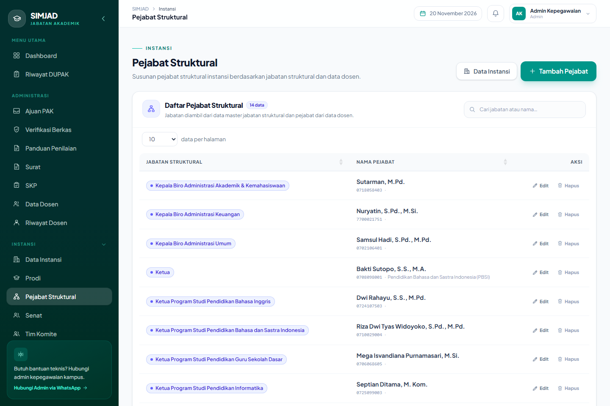

*Gambar 35. Daftar Pejabat Struktural: kolom Jabatan Struktural, Nama Pejabat, dan Aksi.*

Kartu **Daftar Pejabat Struktural** menampilkan lencana jumlah data (contoh *14 data*) dan
keterangan *"Jabatan diambil dari data master jabatan struktural dan pejabat dari data dosen."*

Tabel memakai kolom **JABATAN STRUKTURAL**, **NAMA PEJABAT**, **AKSI**:

- Kolom jabatan menampilkan nama jabatan dalam lencana ungu, misalnya *Kepala Biro Administrasi
  Akademik & Kemahasiswaan*.
- Kolom nama menampilkan nama dosen, NIDN dalam huruf kecil, dan — bila ada — nama prodi di
  belakangnya, misalnya *Ketua — Bakti Sutopo, S.S., M.A. — 0708090001 · Pendidikan Bahasa dan
  Sastra Indonesia (PBSI)*.
- Tombol **Edit** dan **Hapus** pada kolom aksi.

Kotak pencarian berplaceholder *"Cari jabatan atau nama…"*. Tombol **Data Instansi** di kanan atas
kembali ke halaman 11.1.

Menambah pejabat:

1. Tekan **+ Tambah Pejabat**. Halaman **Tambah Pejabat Struktural** terbuka dengan keterangan
   *"Pilih jabatan struktural dan dosen yang menjabat pada posisi tersebut."*
2. Pilih **Jabatan Struktural** — dropdown **Pilih jabatan struktural**. Bila semua jabatan sudah
   terisi, muncul *"Tidak ada jabatan struktural yang bisa dipilih — semua sudah terisi atau
   datanya …"*. Tambah data master lebih dulu di menu **Jabatan Struktural** (Bab 10.3).
3. Pilih **Dosen** — dropdown **Pilih dosen**.
4. Tekan **Simpan Pejabat**. Saat menyunting, judul halaman menjadi **Edit Pejabat Struktural** dan
   tombolnya **Simpan Perubahan**; tersedia juga **Batal** dan tautan **Kembali**.

Bila daftar masih kosong, muncul **"Belum ada data struktur instansi"** dengan tombol **Tambah
Pejabat** di dalamnya.

> **Catatan** — Satu jabatan struktural hanya boleh diisi satu dosen. Untuk mengganti pejabat,
> sunting baris yang ada (**Edit**) atau hapus lebih dulu, jangan menambah baris baru dengan jabatan
> yang sama.

## 11.4 Senat

Menu **Instansi → Senat**. Keterangan halaman: *"Susunan anggota senat instansi beserta
jabatannya, dipilih dari data dosen aktif."*

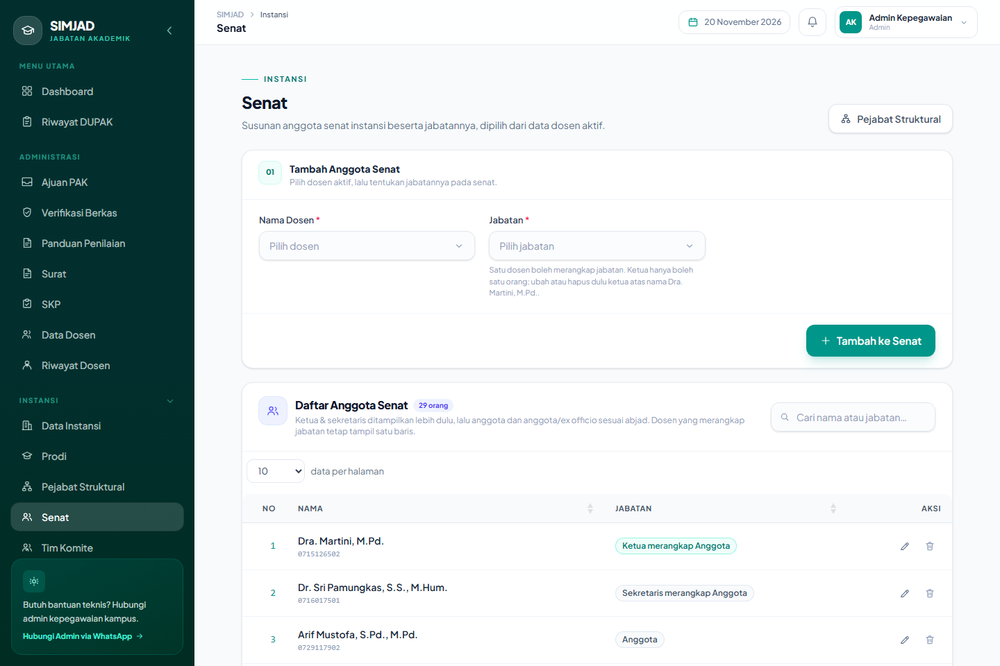

*Gambar 36. Senat: formulir Tambah Anggota Senat di atas, Daftar Anggota Senat di bawah.*

### 01 Tambah Anggota Senat

*"Pilih dosen aktif, lalu tentukan jabatannya pada senat."*

| Isian | Keterangan |
| --- | --- |
| **Nama Dosen** \* | Dropdown **Pilih dosen** dengan pencarian *"Cari nama dosen…"*. Bila tidak ada pilihan, muncul *"Belum ada dosen aktif yang dapat dipilih."* |
| **Jabatan** \* | Dropdown **Pilih jabatan**: **Ketua**, **Sekretaris**, **Anggota**, **Anggota/Ex Officio**. |
| **Merangkap Jabatan** (opsional) | Dropdown **Tidak merangkap**. Keterangan: *"Isi bila dosen merangkap jabatan lain, mis. Ketua merangkap Anggota."* Pilihan mengikuti jabatan utama dan tidak menawarkan jabatan yang sama. |

Keterangan di bawah dropdown jabatan: *"Satu dosen boleh merangkap jabatan. Ketua hanya boleh satu
orang; ubah atau hapus dulu ketua atas nama …"* — nama yang disebut adalah ketua senat saat ini.
Opsi **Ketua** otomatis dinonaktifkan dan diberi akhiran **— sudah terisi** selama ketua belum
diganti. **Ketua tidak dapat dipilih** sebagai jabatan rangkapan.

Tekan **+ Tambah ke Senat**. Saat menyunting, formulir berjudul **Edit Anggota Senat** dan tombolnya
**Simpan Perubahan**.

### Daftar Anggota Senat

Lencana jumlah anggota (contoh *29 orang*) disertai keterangan: *"Ketua & sekretaris ditampilkan
lebih dulu, lalu anggota dan anggota/ex officio sesuai abjad. Dosen yang merangkap jabatan tetap
tampil satu baris."* Kotak pencarian berplaceholder *"Cari nama atau jabatan…"*.

Kolom: **NO**, **NAMA** (nama dosen dan NIDN), **JABATAN**, **AKSI** (ikon pensil dan tempat
sampah). Jabatan tampil sebagai lencana berwarna: hijau untuk **Ketua merangkap Anggota** atau
**Ketua**, abu-abu untuk **Sekretaris merangkap Anggota**, dan sebagainya. Bila kosong: **"Belum
ada anggota senat"**.

Anggota senat yang terdaftar di sini muncul pada pilihan **Anggota Senat** di formulir BAP Senat
(Bab 10.1), dan urutan pilihan di BAP menentukan urutan nama pada daftar hadir cetak.

## 11.5 Tim Komite

Menu **Instansi → Tim Komite**. Keterangan halaman: *"Susunan anggota tim komite instansi beserta
jabatannya, dipilih dari data dosen aktif."*

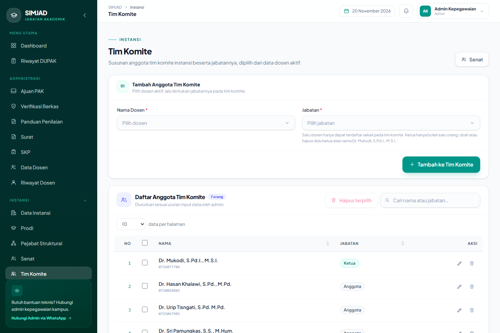

*Gambar 37. Tim Komite: formulir Tambah Anggota Tim Komite dan daftar dengan kotak centang.*

Struktur halaman sama dengan Senat, dengan beberapa perbedaan:

- Bagian **01 Tambah Anggota Tim Komite** — *"Pilih dosen aktif, lalu tentukan jabatannya pada tim
  komite."* Isian **Nama Dosen** \* dan **Jabatan** \* (hanya **Ketua** dan **Anggota**).
- Keterangan pembatas: *"Satu dosen hanya dapat terdaftar sekali pada tim komite. Ketua hanya boleh
  satu orang; ubah atau hapus dulu ketua atas nama Dr. Mukodi, S.Pd.I., M.S.I."*
- Tombol **+ Tambah ke Tim Komite**.
- **Daftar Anggota Tim Komite** — *"Diurutkan sesuai urutan input data oleh admin."* Lencana jumlah
  anggota (contoh *7 orang*), kotak pencarian *"Cari nama atau jabatan…"*, dan tombol **Hapus
  terpilih** di samping pencarian.
- Kolom **NO**, kotak centang, **NAMA**, **JABATAN**, **AKSI**. Centang beberapa baris lalu tekan
  **Hapus terpilih**; label tombol berubah menjadi **Hapus (n)** sesuai jumlah baris yang dicentang.
- Tombol **Senat** di kanan atas berpindah ke halaman 11.4.

Anggota tim komite dipakai pada BAKI (Berita Acara Komite Integritas Akademik) di menu **Surat**.

## 11.6 Panduan Penilaian

Menu **Administrasi → Panduan Penilaian**. Keterangan halaman: *"Acuan penilaian angka kredit yang
dibaca TIM PAK. Unggah berkas PDF atau kirim link berkas, lalu periksa hasilnya pada pratinjau di
bawah."*

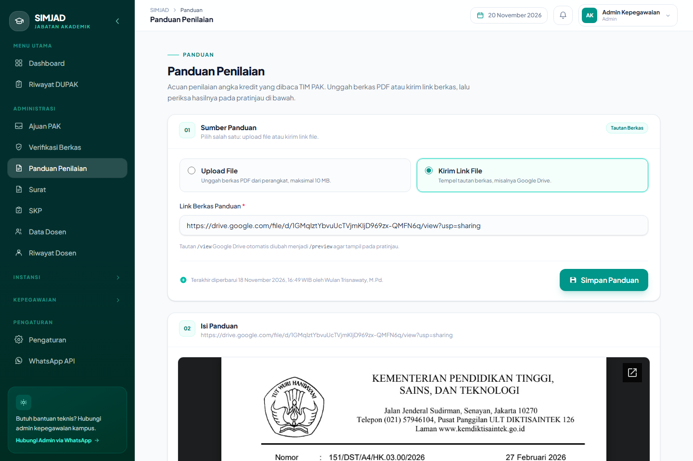

*Gambar 39. Panduan Penilaian: bagian 01 Sumber Panduan dengan mode Kirim Link File aktif.*

### 01 Sumber Panduan

*"Acuan penilaian angka kredit yang dipakai TIM PAK. Isi panduan ditampilkan pada pratinjau di bawah
halaman ini."* Pilih salah satu sumber:

- **Upload File** — *"Unggah berkas PDF dari perangkat, maksimal 10 MB."* Format PDF, maksimal
  `10 MB`.
- **Kirim Link File** — *"Tempat tautan berkas, misalnya Google Drive."* Isi **Link Berkas
  Panduan** \* dengan contoh `https://drive.google.com/file/d/xxxxxxxx/view`. Keterangan: *"Tautan
  `/view` Google Drive otomatis diubah menjadi `/preview` agar tampil pada pratinjau."*

Di bawah formulir tampil keterangan waktu pembaruan terakhir, misalnya *"Terakhir diperbarui 18
November 2026, 16.49 WIB oleh Wulan Trisnawaty, M.Pd."* Tekan **Simpan Panduan** untuk menyimpan.
Lencana **Tautan Berkas** di kanan atas bagian menunjukkan jenis sumber yang sedang dipakai.

### 02 Isi Panduan

Bagian ini menampilkan alamat berkas dan pratinjau dokumen di dalam halaman. Bila pratinjau kosong,
muncul saran: *"Sebagian tautan membatasi tampilan di dalam halaman. Bila pratinjau kosong, buka
tautannya di tab baru."* Tombol **Hapus Panduan** (dengan konfirmasi **Hapus panduan penilaian?**)
mengosongkan panduan; setelah itu muncul ajakan *"Unggah berkas PDF atau kirim link berkas pada
formulir di atas agar TIM PAK dapat membacanya."*

> **Catatan** — Panduan ini dibaca TIM PAK dari menu **Panduan Penilaian** di ruang TIM PAK
> (Bab 12). Perubahan langsung terlihat oleh semua penilai, jadi simpan hanya berkas yang sudah
> final.

## 11.7 Pengaturan sistem

Menu **Pengaturan** pada kelompok **PENGATURAN** di sidebar. Keterangan halaman: *"Kelola token
GitHub untuk pembaruan aplikasi, bersihkan cache, jalankan migrasi tabel, buat symlink storage,
serta backup dan import database. Setiap tindakan dicatat pada terminal log di bawah."*

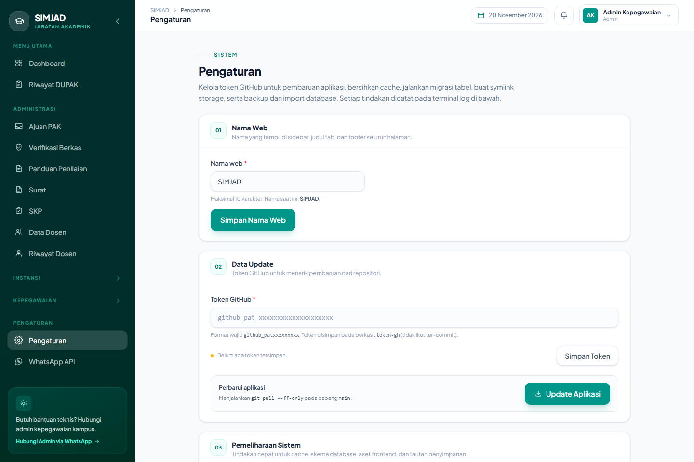

*Gambar 40. Pengaturan: bagian 01 Nama Web dan 02 Data Update.*

Halaman ini terdiri atas lima bagian bernomor.

### 01 Nama Web

*"Nama yang tampil di sidebar, judul tab, dan footer seluruh halaman."* Isian **Nama web** \* dengan
placeholder `Contoh: Athena`, **maksimal 10 karakter**. Keterangan di bawahnya menyebut nama yang
sedang dipakai, misalnya *"Nama saat ini: SIMJAD"*. Tekan **Simpan Nama Web**.

### 02 Data Update

*"Token GitHub untuk menarik pembaruan dari repositori."*

- **Token GitHub** \* — placeholder `github_pat_xxxxxxxxxxxxxxxxxxxx`. Keterangan: *"Format wajib
  `github_patxxxxxxxxx`. Token disimpan pada berkas `.token-gh` (tidak ikut ter-commit)."*
- Titik status di bawah isian: hijau dengan teks **Token tersimpan: …** bila sudah ada, atau kuning
  dengan teks **Belum ada token tersimpan.** Tekan **Simpan Token**.
- Kotak **Perbarui aplikasi** — *"Menjalankan `git pull --ff-only` pada cabang main."* Tekan
  **Update Aplikasi**.

### 03 Pemeliharaan Sistem

*"Tindakan cepat untuk cache, skema database, aset frontend, dan tautan penyimpanan."* Empat baris
tindakan:

| Tindakan | Perintah yang dijalankan | Tombol |
| --- | --- | --- |
| **Clear cache** | `php artisan optimize:clear` | **Bersihkan Cache** |
| **Migrasi tabel** | `php artisan migrate --force` | **Migrasi Tabel** (konfirmasi *"Jalankan migrasi tabel database sekarang?"*) |
| **Symlink storage** | `php artisan storage:link --force` | **Buat Symlink**. Lencana **Tertaut** (hijau) atau **Belum** (kuning) menunjukkan status tautan. |
| **Build aset (CSS & JS)** | `npm run build` — *"Lakukan setelah menarik pembaruan aplikasi."* | **Build Aset** |

### 04 Backup & Import Database

*"Unduh salinan seluruh tabel, atau pulihkan database dari berkas `.sql`."*

- **Backup database** — *"Menulis struktur dan isi seluruh tabel, lalu mengunduhnya sebagai berkas
  `backup-YYYYMMDD-HHMMSS.sql`."* Tekan **Backup Database** dan setujui konfirmasi **Backup
  database?** Selama proses berjalan muncul bilah kemajuan; setelah selesai tersedia tautan **Unduh
  ulang hasil backup**.
- **Import database** — pilih **Berkas backup** \* (`.sql`, maksimal `100 MB`). Keterangan: *"Berkas
  dijalankan bertahap sehingga tabel yang namanya sama akan ditimpa."* Tekan **Import Database** dan
  setujui konfirmasi **Import database?**
- **Hapus seluruh data** — *"Mengosongkan profil, riwayat, kegiatan, pengajuan, dan berkas syarat
  khusus seluruh dosen. Akun pengguna, nama web, serta data master (instansi, prodi, jabatan,
  kepangkatan) tetap disimpan."* Tombol merah **Hapus Semua Data** meminta konfirmasi **Hapus seluruh
  data?**

### 05 Terminal log

*"Setiap tindakan dicatat pada terminal log di bawah."* Bagian ini menampilkan jumlah tindakan
(contoh *"3 tindakan"*) dan isi log sesi berjalan. Bila belum ada, muncul *"belum ada tindakan pada
sesi ini."* Tombol **Hapus log** mengosongkan seluruh isi terminal log.

> **Peringatan** — **Import Database** menimpa tabel yang namanya sama, dan **Hapus Semua Data**
> menghapus permanen seluruh data dosen. Selalu tekan **Backup Database** lebih dulu. Kedua tindakan
> tidak dapat dibatalkan.

## 11.8 WhatsApp API

Menu **Pengaturan → WhatsApp API**. Keterangan halaman: *"Hubungkan aplikasi ke WhatsApp gateway,
pantau status koneksi secara realtime, dan uji pengiriman pesan."* Lencana di kanan atas menunjukkan
keadaan konfigurasi, misalnya **Gateway tersimpan**.

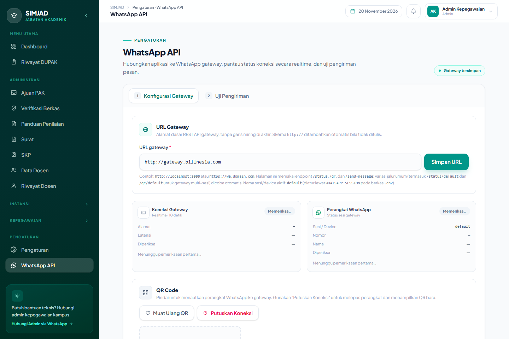

*Gambar 41. WhatsApp API tab Konfigurasi Gateway: URL gateway, kartu status, dan QR Code.*

Halaman memiliki dua tab: **1 Konfigurasi Gateway** dan **2 Uji Pengiriman**.

### Tab 1 — Konfigurasi Gateway

- **URL Gateway** — *"Alamat dasar REST API gateway, tanpa garis miring di akhir. Skema `http://`
  ditambahkan otomatis bila tidak ditulis."* Placeholder `http://localhost:3000`. Keterangan
  tambahan: halaman memakai endpoint `/status`, `/qr`, dan `/send-message`; variasi jalur umum
  (termasuk `/status/default` dan `/qr/default` untuk gateway multi-sesi) dicoba otomatis. Nama
  sesi/device aktif mengikuti `WHATSAPP_SESSION` pada berkas `.env`. Tekan **Simpan URL**.
- **Koneksi Gateway** — kartu *"Realtime · 10 detik"* berisi **Alamat**, **Latensi**, dan
  **Diperiksa**. Selama pemeriksaan pertama muncul **Memeriksa…** dan *"Menunggu pemeriksaan
  pertama…"*.
- **Perangkat WhatsApp** — kartu *"Status sesi gateway"* berisi **Sesi / Device** (contoh `default`),
  **Nomor**, **Nama**, dan **Diperiksa**.
- **QR Code** — *"Pindai untuk menautkan perangkat WhatsApp ke gateway. Gunakan 'Putuskan Koneksi'
  untuk melepas perangkat dan menampilkan QR baru."* Tombol **Muat Ulang QR** dan **Putuskan
  Koneksi**. Keterangan: *"QR diperbarui otomatis setiap 20 detik selama WhatsApp belum terhubung.
  Setelah berhasil dipindai, blok ini akan berubah menjadi status terhubung."* Tersedia juga tautan
  **Buka QR langsung di gateway** dan **Lihat respons status mentah**. Selama menunggu, kotak QR
  menampilkan *"QR code akan tampil setelah status gateway diperiksa."*

### Tab 2 — Uji Pengiriman

Judul bagian **Kirim Pesan Uji** dengan keterangan *"Pesan benar-benar dikirim ke nomor tujuan
melalui gateway yang tersimpan."*

| Isian | Keterangan |
| --- | --- |
| **Nomor tujuan** \* | Placeholder `0812-3456-7890`. Nomor berawalan `0` diubah menjadi `62` sebelum dikirim. |
| **Pesan** | Placeholder `Contoh: Uji koneksi WhatsApp API Athena berhasil.` |

Tekan **Kirim Pesan Uji**; hasil pengiriman tampil pada tab yang sama.

> **Catatan** — Bila gateway belum menyala, kartu status tetap menampilkan **Memeriksa…** dan QR
> tidak muncul. Periksa alamat gateway lebih dulu, lalu tekan **Muat Ulang QR**.

---

# 12. Ruang TIM PAK

TIM PAK (Tim Penilai Angka Kredit) bekerja pada satu tugas: memberi angka kredit atas setiap butir
kegiatan yang diajukan dosen. Menu yang tersedia hanya **Dashboard**, **Pengajuan Masuk**, dan
**Panduan Penilaian**.

## 12.1 Dashboard TIM PAK


*Gambar 43. Dashboard TIM PAK: banner RUANG TIM PAK, lima kartu ringkasan, dan tabel pengajuan masuk
(gambar yang sama dipakai pada Bab 3.3).*

Halaman dibuka dengan banner hijau bertanda **RUANG TIM PAK** dan sapaan *"Selamat pagi, Wulan!"*
disertai ajakan *"Tinjau dan nilai usulan angka kredit dosen yang masuk."* Di kanan banner tampil
kotak **PERIODE AKTIF** (contoh *2026*) dan tombol **Pengajuan Masuk**.

Lima kartu ringkasan:

| Kartu | Arti |
| --- | --- |
| **Total Pengajuan** (label *Semua*) | Seluruh ajuan DUPAK dosen. |
| **Belum Dinilai** (*Proses*) | *"Menunggu penilaian TIM PAK"*. |
| **Disetujui** (*Final*) | *"Ajuan yang telah disetujui"*. |
| **Perlu Perbaikan** (*Revisi*) | *"Dikembalikan ke dosen"*. |
| **Ditolak** (*Tolak*) | *"DUPAK ditolak admin"*. |

Di bawahnya, kartu **Pengajuan DUPAK Masuk** dengan lencana jumlah data dan keterangan *"Daftar
pengajuan DUPAK yang masuk dari dosen untuk dinilai."* Tersedia kotak pencarian *"Cari dosen,
periode…"*, filter **Semua status**, dan pilihan **10 / 25 / 50 / 100** data per halaman. Kolom:
**DOSEN** (nama, NIDN, dan tanda `—` bila prodi kosong), **PERIODE**, **STATUS**, **DIAJUKAN**, dan
**AKSI** berisi tombol **Nilai**.

## 12.2 Pengajuan Masuk

Menu **Penilaian → Pengajuan Masuk**. Judul halaman **Pengajuan DUPAK Masuk**, keterangan: *"Daftar
usulan angka kredit yang dikirim dosen. Buka salah satu baris untuk mengisi kolom angka kredit
baru."*

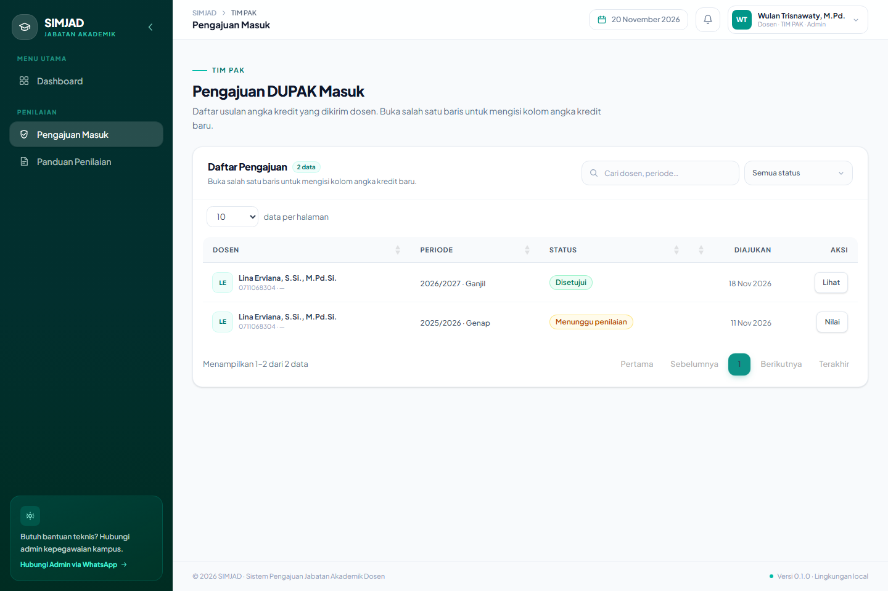

*Gambar 44. Pengajuan Masuk: dua ajuan contoh, status Disetujui dan Menunggu penilaian.*

Kartu **Daftar Pengajuan** memuat lencana jumlah data dan pengingat *"Buka salah satu baris untuk
mengisi kolom angka kredit baru."* Alat bantu yang sama seperti dashboard: pencarian *"Cari dosen,
periode…"*, filter **Semua status**, dan pilihan jumlah baris per halaman.

Tombol pada kolom **AKSI** menyesuaikan keadaan ajuan:

| Keadaan ajuan | Tombol |
| --- | --- |
| Belum dinilai (**Menunggu penilaian**) | **Nilai** |
| Sudah dinilai, belum diputuskan | **Lihat / Ubah** |
| Sudah **Disetujui** admin (nilai terkunci) | **Lihat** |

Klik judul kolom **DOSEN**, **PERIODE**, **STATUS**, atau **DIAJUKAN** untuk mengurutkan. Bila tidak
ada data, muncul **"Belum ada pengajuan masuk"**.

## 12.3 Menilai satu pengajuan

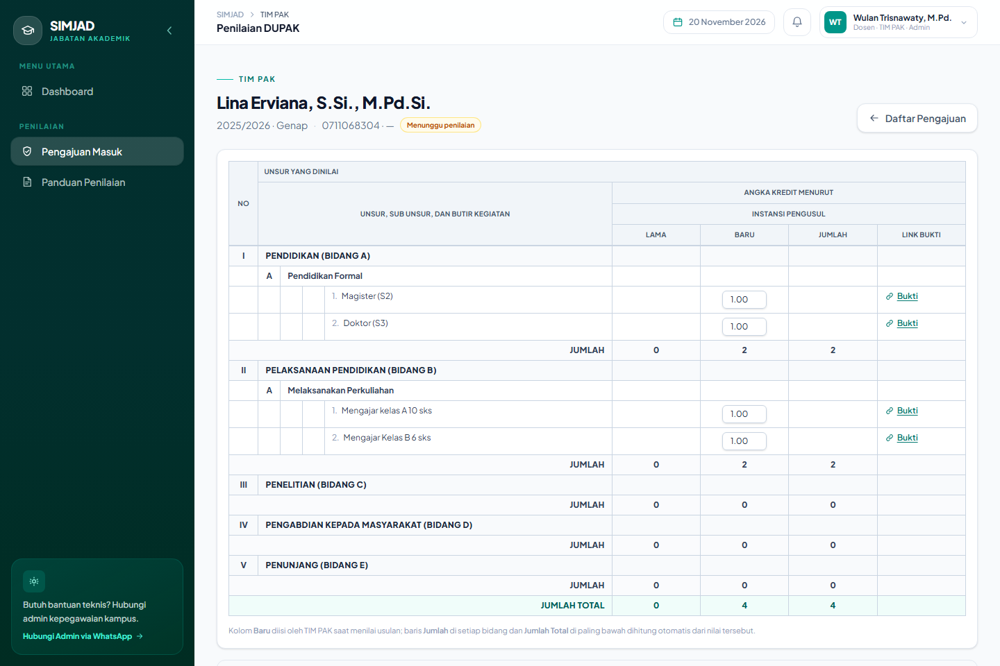

*Gambar 45. Halaman penilaian: rekap bergaya formulir DUPAK dengan kolom isian Baru.*

Halaman **Penilaian DUPAK** menampilkan nama dosen sebagai judul, lalu baris keterangan berisi
periode (contoh *2025/2026 · Genap*), NIDN, prodi, dan lencana status (contoh **Menunggu
penilaian**). Tombol **← Daftar Pengajuan** di kanan atas kembali ke daftar.

Tabel penilaian disusun seperti formulir DUPAK:

- Baris kepala **UNSUR YANG DINILAI** dengan kolom **NO** dan **UNSUR, SUB UNSUR, DAN BUTIR
  KEGIATAN**, serta grup **ANGKA KREDIT MENURUT** → **INSTANSI PENGUSUL** dengan subkolom **LAMA**,
  **BARU**, **JUMLAH**, dan **LINK BUKTI**.
- Lima bidang: **I PENDIDIKAN (BIDANG A)**, **II PELAKSANAAN PENDIDIKAN (BIDANG B)**, **III
  PENELITIAN (BIDANG C)**, **IV PENGABDIAN KEPADA MASYARAKAT (BIDANG D)**, dan **V PENUNJANG (BIDANG
  E)**.
- Setiap bidang dipecah menjadi komponen (A, B, …), rincian komponen (1, 2, …), lalu butir kegiatan.
  Contoh pada Bidang A: *1. Magister (S2)* dan *2. Doktor (S3)*; pada Bidang B: *1. Mengajar kelas
  A 10 sks* dan *2. Mengajar Kelas B 6 sks*.
- Kolom **LAMA** berisi angka yang sudah ada, kolom **BARU** berisi kotak isian (contoh `1.00`), dan
  kolom **JUMLAH** terisi otomatis.
- Kolom **LINK BUKTI** memuat tautan **Bukti** untuk membuka bukti kegiatan di tab baru. Periksa
  setiap bukti sebelum memberi nilai.
- Baris **JUMLAH** per bidang dan baris **JUMLAH TOTAL** di paling bawah dihitung otomatis dari
  angka yang Anda isi.

Keterangan di bawah tabel: *"Kolom Baru diisi oleh TIM PAK saat menilai usulan; baris Jumlah di
setiap bidang dan Jumlah Total di paling bawah dihitung otomatis dari nilai tersebut."*

Langkah menilai:

1. Buka **Pengajuan Masuk**, tekan **Nilai** pada baris dosen.
2. Periksa setiap butir dan bukti lewat tautan **Bukti**.
3. Isi kolom **Baru** untuk butir yang dinilai. Butir tanpa angka dianggap nol.
4. Periksa baris **JUMLAH** tiap bidang dan **JUMLAH TOTAL**.
5. Tekan **Update Nilai**. Muncul konfirmasi **Simpan penilaian?** dengan pesan *"Nilai angka
   kredit akan disimpan dan langsung terlihat oleh dosen."* Setujui untuk menyimpan.

Setelah disimpan, dosen melihat nilai tersebut pada tab **Review** pengajuannya dan dapat menekan
**Ajukan Dupak** (Bab 5.6).

> **Peringatan** — Nilai yang sudah tersimpan langsung terlihat oleh dosen. Bila ajuan sudah
> **Disetujui** admin, halaman ini berubah menjadi hanya-baca: keterangan *"DUPAK periode ini sudah
> disetujui admin. Nilai terkunci dan halaman ini hanya untuk dilihat."* dan tombol **Update Nilai**
> dinonaktifkan.

## 12.4 Panduan Penilaian untuk TIM PAK

Menu **Penilaian → Panduan Penilaian** menampilkan judul **Panduan Penilaian** dengan keterangan
*"Acuan penilaian angka kredit yang dipakai TIM PAK. Isi panduan ditampilkan pada pratinjau di bawah
halaman ini."* Isinya berasal dari berkas yang diunggah admin pada Bab 11.6.

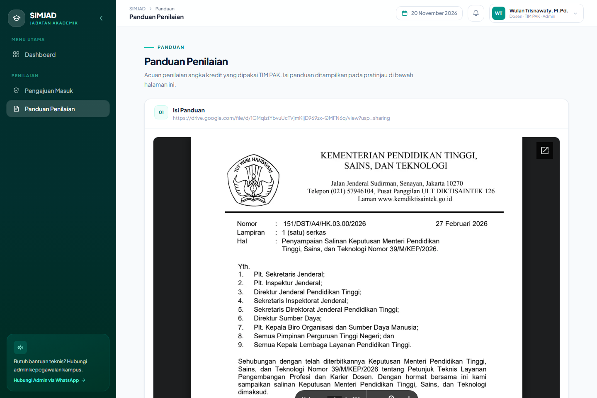

*Gambar 46. Panduan Penilaian di ruang TIM PAK: kartu Isi Panduan dan pratinjau dokumen acuan.*

Kartu **01 Isi Panduan** menampilkan alamat berkas atau tautan yang dipakai, lalu pratinjau dokumen di
bawahnya. Ikon di sudut kanan atas pratinjau membuka dokumen pada tab baru — berguna bila ingin
memperbesar atau mencetak. Gunakan halaman ini sebagai rujukan angka kredit sebelum mengisi kolom
**Baru**.

Bila admin belum mengisi panduan, halaman menampilkan ajakan agar admin mengunggah berkas lebih dulu.

---

# 13. SKP: Keberatan dan Usulan

Sasaran Kinerja Pegawai (SKP) dinilai lewat enam unsur perilaku kerja. Bab ini menjelaskan dua sisi
yang saling berhadapan: dosen yang **menerima** penilaian (menu **SKP-Dosen**) dan dosen yang
**memberi** penilaian karena ditugaskan admin sebagai Pejabat Penilai atau Atasan Pejabat Penilai
(menu **Usulan SKP**).

## 13.1 SKP-Dosen: daftar penilaian yang diterima

Menu **SKP-Dosen** menampilkan judul **SKP-Dosen** dengan keterangan *"Hasil penilaian SKP dari
Pejabat Penilai untuk Anda. Ajukan keberatan bila ada nilai yang tidak sesuai, atau setujui bila
sudah sesuai."*

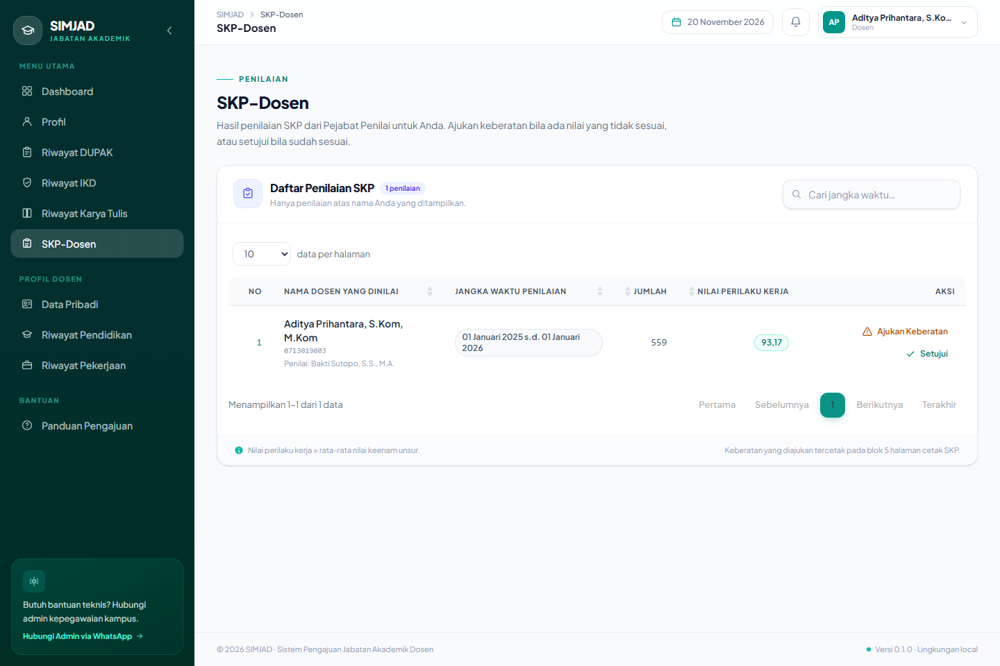

*Gambar 47. SKP-Dosen: satu baris penilaian dengan tombol Ajukan Keberatan dan Setujui.*

Kartu **Daftar Penilaian SKP** berlabel jumlah penilaian dan keterangan *"Hanya penilaian atas nama
Anda yang ditampilkan."* Kotak pencarian *"Cari jangka waktu…"* dan pilihan **10 / 25 / 50 / 100**
data per halaman tersedia di atas tabel.

Kolom tabel: **NO**, **NAMA DOSEN YANG DINILAI** (nama, NIDN, dan *"Penilai: …"*), **JANGKA WAKTU
PENILAIAN** (contoh *01 Januari 2025 s.d. 01 Januari 2026*), **JUMLAH** (contoh `559`), **NILAI
PERILAKU KERJA** (lencana angka, contoh `93,17`), dan **AKSI**.

Isi kolom **AKSI** bergantung pada keadaan penilaian:

| Keadaan | Tampilan pada kolom AKSI |
| --- | --- |
| Belum dinilai Pejabat Penilai | Teks *"Menunggu penilaian"*. |
| Sudah dinilai, belum disetujui | **Ajukan Keberatan** dan **Setujui**. |
| Keberatan sudah diajukan | **Ubah Keberatan** + *"Keberatan diajukan 12 Maret 2026"*. |
| Sudah disetujui dosen | Lencana **Disetujui** dan tombol **Batalkan Persetujuan**. |
| Sudah disetujui atasan penilai | Lencana **Disetujui** + *"Sudah disetujui atasan penilai"*. |

Dua catatan di kaki kartu: *"Nilai perilaku kerja = rata-rata nilai keenam unsur."* dan *"Keberatan
yang diajukan tercetak pada blok 5 halaman cetak SKP."*

## 13.2 Mengajukan keberatan

Tekan **Ajukan Keberatan** pada baris penilaian. Halaman **Ajukan Keberatan SKP** terbuka dengan
tautan **← Kembali ke SKP-Dosen** di kiri atas dan keterangan *"Ajukan keberatan atas nilai SKP yang
Anda terima beserta tanggal pengajuannya. Keberatan tercetak pada blok 5 halaman cetak SKP."*

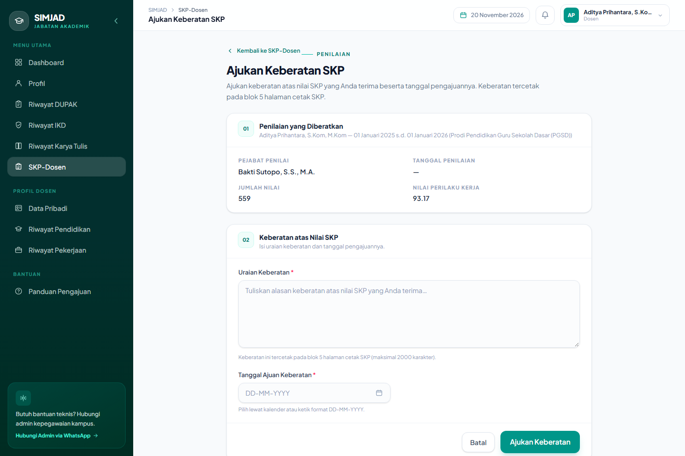

*Gambar 48. Formulir keberatan: ringkasan penilaian (01) dan isian keberatan (02).*

Halaman dibagi dua blok bernomor:

1. **Penilaian yang Diberatkan** — hanya-baca. Memuat nama dosen, periode dan prodi (contoh
   *Aditya Prihantara, S.Kom, M.Kom — 01 Januari 2025 s.d. 01 Januari 2026 (Prodi Pendidikan Guru
   Sekolah Dasar (PGSD))*), lalu **PEJABAT PENILAI**, **TANGGAL PENILAIAN**, **JUMLAH NILAI**, dan
   **NILAI PERILAKU KERJA**. Periksa dulu angka-angka ini.
2. **Keberatan atas Nilai SKP** — *"Isi uraian keberatan dan tanggal pengajuannya."* Dua isian wajib:
   - **Uraian Keberatan** (wajib) — kotak teks, plaseholder *"Tuliskan alasan keberatan atas nilai SKP
     yang Anda terima…"*, keterangan *"Keberatan ini tercetak pada blok 5 halaman cetak SKP
     (maksimal 2000 karakter)."*
   - **Tanggal Ajuan Keberatan** (wajib) — plaseholder `DD-MM-YYYY`, *"Pilih lewat kalender atau ketik
     format DD-MM-YYYY."*

Tekan **Ajukan Keberatan** untuk menyimpan, atau **Batal** untuk kembali tanpa mengubah apa pun.
Setelah tersimpan, halaman daftar menampilkan tautan **Ubah Keberatan** beserta tanggal keberatan.

> **Catatan** — Satu penilaian hanya punya satu keberatan. Menekan **Ubah Keberatan** memperbarui
> uraian dan tanggal yang sama, bukan menambah keberatan baru.

Setelah keberatan diajukan, Pejabat Penilai menulis tanggapan (13.4), lalu dosen dapat menekan
**Setujui**. Tombol ini meminta konfirmasi **"Setujui penilaian SKP periode 2025/2026 tanpa
keberatan?"** — persetujuan mengunci nilai dari perubahan Pejabat Penilai. Bila belum disetujui
atasan penilai, persetujuan masih dapat dibatalkan lewat **Batalkan Persetujuan** (konfirmasi:
*"Batalkan persetujuan penilaian SKP periode 2025/2026? Nilai dapat diubah kembali oleh Pejabat
Penilai."*).

## 13.3 Usulan SKP: menilai perilaku kerja dosen lain

Menu **Usulan SKP** dipakai bila admin menugaskan Anda sebagai **Pejabat Penilai** atau **Atasan
Pejabat Penilai** SKP. Keterangannya: *"Daftar dosen yang perlu Anda nilai perilaku kerjanya sebagai
Pejabat Penilai SKP, atau yang menunggu keputusan keberatan dan persetujuan Anda sebagai Atasan
Pejabat Penilai."*

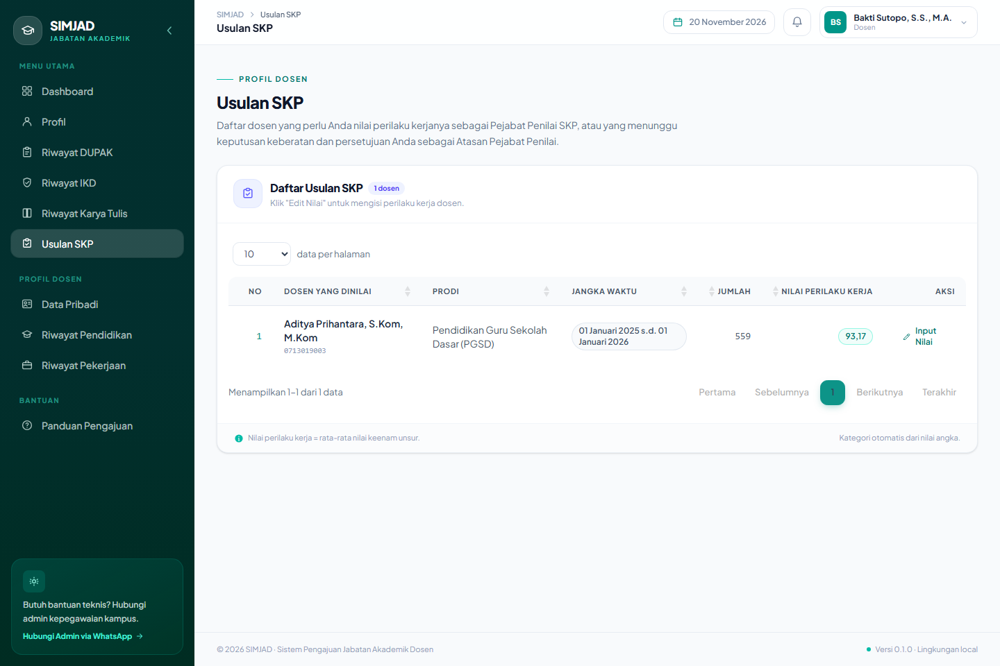

*Gambar 49. Usulan SKP: daftar dosen yang menunggu penilaian, dengan tombol Input Nilai.*

Kartu **Daftar Usulan SKP** berlabel jumlah dosen dan pengingat *"Klik "Edit Nilai" untuk mengisi
perilaku kerja dosen."* Kolom tabel: **NO**, **DOSEN YANG DINILAI** (nama + NIDN), **PRODI**,
**JANGKA WAKTU** (contoh *01 Januari 2025 s.d. 01 Januari 2026*), **JUMLAH** (contoh `559`), **NILAI
PERILAKU KERJA** (lencana angka, contoh `93,17`), dan **AKSI**.

Isi kolom **AKSI**:

| Peran Anda pada SKP itu | Tindakan yang tampil |
| --- | --- |
| Pejabat Penilai, belum disetujui dosen | **Input Nilai**, dan **Tanggapan Keberatan** / **Ubah Tanggapan** bila dosen mengajukan keberatan. |
| Pejabat Penilai, dosen sudah menyetujui | Lencana **Disetujui dosen** (nilai terkunci). |
| Atasan Pejabat Penilai | **Keputusan atas Keberatan** / **Ubah Keputusan** bila syaratnya terpenuhi, serta isian **tanggal persetujuan** + tombol **Setujui**. |

Bila belum ada penugasan, muncul **"Belum ada dosen yang perlu dinilai"** dengan keterangan *"Admin
akan menugaskan Anda sebagai Pejabat Penilai SKP."*

### Mengisi nilai

Klik **Input Nilai** (atau **Edit Nilai**). Formulir **01 Nilai Perilaku Kerja** terbuka di atas
tabel, memuat nama dosen, periode, dan prodi. Aturan kategori tertera di dalam formulir: **≥86 Sangat
Baik · 71–85 Baik · 56–70 Cukup · ≤55 Kurang**. *"Jumlah dan nilai perilaku kerja (rata-rata nilai)
dihitung otomatis."*

Enam isian wajib, masing-masing bilangan bulat `0`–`100`:

| Unsur | Keterangan |
| --- | --- |
| **Orientasi Pelayanan** | Sikap terhadap pelayanan. |
| **Integritas** | Kejujuran dan konsistensi. |
| **Komitmen** | Kesetiaan pada tugas dan organisasi. |
| **Disiplin** | Ketaatan pada aturan waktu dan kerja. |
| **Kerjasama** | Kemampuan bekerja bersama. |
| **Kepemimpinan** | Kemampuan memimpin dan mengarahkan. |

Terakhir isi **Tanggal Penilaian** (plaseholder `DD-MM-YYYY`) — tanggal ini tercetak pada blok 9
halaman cetak SKP (*"DIBUAT TANGGAL, ..."*). Tekan **Simpan Nilai**, atau **Batal** untuk menutup
formulir.

> **Peringatan** — Bila ada isian yang salah, muncul kotak **"Periksa kembali data Anda."** dengan
> *"Terdapat N isian yang perlu diperbaiki sebelum data dapat disimpan."* Pesan yang mungkin muncul:
> *"Nilai wajib diisi untuk seluruh unsur perilaku kerja."*, *"Nilai angka harus antara 0 sampai
> 100."*, dan *"Tanggal penilaian harus berformat DD-MM-YYYY."*

Setelah disimpan, dosen menerima notifikasi WhatsApp dan nilai muncul pada menu **SKP-Dosen** miliknya
untuk disetujui atau diberatkan (13.1–13.2).

## 13.4 Menanggapi keberatan dosen

Bila dosen mengajukan keberatan, tautan **Tanggapan Keberatan** muncul pada kolom **AKSI**. Halaman
**Tanggapan Keberatan SKP** berisi keterangan *"Tanggapi keberatan yang diajukan dosen beserta tanggal
tanggapan. Tanggapan tercetak pada blok 6 halaman cetak SKP."*

1. Blok **Uraian Keberatan** — hanya-baca, berisi alasan yang ditulis dosen.
2. Blok **Tanggapan atas Keberatan** — *"Isi tanggapan dan tanggal tanggapan."* Isi **Tanggapan
   Keberatan** (wajib, maksimal 2000 karakter, plaseholder *"Tuliskan tanggapan atas keberatan
   dosen…"*) dan **Tanggal Tanggapan** (wajib, `DD-MM-YYYY`).
3. Tekan **Simpan Tanggapan** — berubah menjadi **Perbarui Tanggapan** bila sudah pernah disimpan.

## 13.5 Keputusan dan persetujuan Atasan Pejabat Penilai

Sebagai **Atasan Pejabat Penilai**, Anda menutup rangkaian SKP:

1. **Keputusan atas Keberatan** — tautan ini hanya aktif bila keberatan sudah ditanggapi Pejabat
   Penilai dan sudah disetujui dosen. Halaman **Keputusan atas Keberatan SKP** menampilkan ringkasan
   tiga tanggal (**Keberatan Dosen**, **Tanggapan Pejabat Penilai**, **Persetujuan Dosen**) lalu
   meminta **Keputusan** (wajib, maksimal 2000 karakter) dan **Tanggal Keputusan** (`DD-MM-YYYY`).
   Tombolnya **Simpan Keputusan** / **Perbarui Keputusan**. Keputusan tercetak pada blok 7 halaman
   cetak SKP.
2. **Setujui** — isi **tanggal persetujuan** (`DD-MM-YYYY`, terisi tanggal hari ini) pada kolom
   **AKSI**, lalu tekan **Setujui**. Persetujuan baru bisa dilakukan setelah dosen menyetujui
   penilaian, dan tercetak pada blok 11 halaman cetak SKP.

Setelah atasan menyetujui, dosen tidak dapat lagi membatalkan persetujuannya dan Pejabat Penilai tidak
dapat mengubah nilai.

---

# 14. Referensi status dan alur DUPAK

Bab ini merangkum seluruh status yang mungkin Anda temui beserta siapa yang berwenang mengubahnya.
Gunakan bab ini saat lencana status pada layar tidak Anda pahami.

## 14.1 Status usulan DUPAK

| Status di layar | Arti | Yang bertindak berikutnya |
| --- | --- | --- |
| **Menunggu penugasan admin** | Kegiatan sudah diajukan dosen, tetapi admin belum menugaskan TIM PAK. | Admin (menugaskan TIM PAK). |
| **Menunggu penilaian** | Sudah sampai di meja TIM PAK, angka kredit belum diisi. | TIM PAK (Bab 12.3). |
| **Sudah dinilai** | TIM PAK selesai mengisi kolom **Baru**. | Dosen — memeriksa hasil lalu menekan **Ajukan Dupak**. |
| **Diajukan DUPAK** | Dosen sudah mengajukan usulan; menunggu keputusan admin. | Admin (Bab 9.2). |
| **Disetujui** | Admin menyetujui; angka kredit terkunci dan DUPAK siap dicetak. | Dosen (mencetak DUPAK). |
| **Butuh Perbaikan** | Dikembalikan admin dengan catatan; entri masih dapat diubah. | Dosen (memperbaiki lalu mengajukan ulang). |
| **Ditolak** | Usulan dihentikan admin dengan alasan tertulis. | Tidak ada — periode dapat diajukan lagi pada periode berikutnya. |

Status **Diajukan DUPAK**, **Disetujui**, **Butuh Perbaikan**, dan **Ditolak** dihitung sebagai
tahap DUPAK, sehingga periodenya tampil pada menu **Riwayat DUPAK** — bukan lagi pada daftar
pengajuan kegiatan.

## 14.2 Status berkas syarat khusus (BKD dan IKD)

| Status di layar | Arti | Yang bertindak berikutnya |
| --- | --- | --- |
| **Belum diajukan** | Berkas belum diunggah, atau masih berupa draf. | Dosen (mengunggah berkas). |
| **Menunggu verifikasi** | Berkas sudah dikirim dan menunggu pemeriksaan admin. | Admin (Bab 9.1). |
| **Diterima** | Berkas lolos verifikasi. | Dosen (melanjutkan pengisian kegiatan). |
| **Ditolak** | Berkas dikembalikan dengan catatan per jenis berkas. | Dosen (mengunggah ulang). |

Status BKD dan IKD disimpan terpisah, lalu status ajuan keseluruhan diturunkan darinya: bila salah
satu **Ditolak** maka ajuan **Ditolak**; bila ada yang **Menunggu verifikasi** maka ajuan **Menunggu
verifikasi**; bila masih ada yang **Belum diajukan** maka ajuan **Belum diajukan**.

## 14.3 Status pengajuan jabatan

| Status di layar | Arti |
| --- | --- |
| **Draft** | Baru disimpan, belum dikirim. |
| **Diajukan** | Sudah dikirim untuk diperiksa. |
| **Diverifikasi** | Lolos pemeriksaan berkas. |
| **Disetujui** | Usulan jabatan disetujui. |
| **Ditolak** | Usulan jabatan ditolak. |

## 14.4 Status SKP

| Keadaan | Penanda pada layar | Siapa yang bertindak |
| --- | --- | --- |
| Belum dinilai | *"Menunggu penilaian"* pada **SKP-Dosen** | Pejabat Penilai (Bab 13.3). |
| Sudah dinilai | Lencana angka pada **NILAI PERILAKU KERJA**; tombol **Ajukan Keberatan** dan **Setujui** muncul | Dosen (Bab 13.2). |
| Keberatan diajukan | **Ubah Keberatan** + *"Keberatan diajukan …"*; tombol **Tanggapan Keberatan** di sisi penilai | Pejabat Penilai (Bab 13.4). |
| Disetujui dosen | Lencana **Disetujui** pada **SKP-Dosen**, **Disetujui dosen** pada **Usulan SKP** | Atasan Pejabat Penilai (Bab 13.5). |
| Diputuskan atasan | **Ubah Keputusan** pada kolom **AKSI** | Atasan Pejabat Penilai (menyetujui). |
| Selesai | *"Sudah disetujui atasan penilai"* | Tidak ada — dokumen siap dicetak admin. |

Nilai SKP terkunci selama dosen sudah menyetujui. Pejabat Penilai baru dapat mengubahnya kembali bila
dosen menekan **Batalkan Persetujuan** — dan pembatalan itu tidak tersedia lagi setelah atasan
menyetujui.

## 14.5 Siapa berwenang atas apa

| Tindakan | Dosen | TIM PAK | Admin |
| --- | --- | --- | --- |
| Mengisi entri kegiatan | ✔ | — | — |
| Mengajukan ke TIM PAK | ✔ | — | — |
| Menugaskan TIM PAK | — | — | ✔ |
| Mengisi angka kredit (**Baru**) | — | ✔ | — |
| Mengajukan DUPAK | ✔ | — | — |
| Menyetujui / mengembalikan / menolak DUPAK | — | — | ✔ |
| Mencetak DUPAK dan lampirannya | ✔ | — | ✔ |
| Verifikasi BKD dan IKD | mengunggah | — | ✔ memutuskan |
| Menilai SKP | menerima/menyanggah | — | ✔ (Pejabat Penilai ditunjuk admin) |
| Mengubah data instansi dan pengaturan | — | — | ✔ |

> **Catatan** — Satu akun dapat memegang lebih dari satu peran. Bila tombol yang Anda butuhkan tidak
> tampil, periksa peran aktif pada menu akun di kanan atas (Bab 2.3) — kemungkinan Anda sedang berada
> pada peran yang berbeda.

---

# 15. Pertanyaan umum dan penanganan masalah

## 15.1 Masuk dan akun

**Saya lupa password. Bagaimana mengatasinya?**

Aplikasi tidak menyediakan pemulihan mandiri. Pada halaman masuk, klik **Lupa password?** — tautan itu
membuka aplikasi surel dengan alamat admin dan subjek *"Bantuan akun SIMJAD"* (nama web mengikuti
**Pengaturan → Nama Web**). Anda juga dapat memakai tombol **Hubungi Admin via WhatsApp** di bagian
bawah sidebar. Admin akan mengatur ulang kata sandi Anda dari menu **Administrasi → Data Dosen**.

**NIDN saya ditolak saat masuk.**

Pastikan yang diketik adalah NIDN (bukan NIP atau surel) dan tanpa spasi. Bila tetap gagal, akun Anda
mungkin belum dibuat admin — minta admin menambahkannya lewat **Data Dosen** atau **Import Data
Dosen** (Bab 8).

**Menu saya tidak selengkap rekan saya.**

Menu ditentukan oleh peran aktif. Bila akun Anda memegang lebih dari satu peran, halaman **Pilih
peran** muncul setelah masuk (Gambar 42, Bab 2.3). Pilih peran lain untuk melihat menunya.

**Halaman menampilkan "403" atau "Anda tidak memiliki akses".**

Anda membuka halaman milik peran lain — misalnya tautan lama TIM PAK dibuka saat peran **Dosen**
aktif. Kembali ke **Dashboard** lalu ganti peran.

## 15.2 Pengisian kegiatan dan pengajuan

**Tombol pengisian kegiatan tidak muncul pada periode tertentu.**

Periode yang sudah **Disetujui** admin terkunci: tombol **Ajukan ke TIM PAK** tidak aktif dan nilai
tidak dapat diubah lagi. Gunakan periode berikutnya untuk kegiatan baru. Untuk periode yang belum ada
sama sekali, buat lewat **Pengajuan Baru** (Bab 5.2).

**Bukti kegiatan ditolak saat disimpan.**

Kolom **Link Bukti** hanya menerima alamat lengkap yang dimulai `http://` atau `https://`. Unggah
berkas bukti ke penyimpanan daring (Google Drive, OneDrive, dan sejenisnya), atur agar dapat dibuka
publik, lalu tempelkan tautannya. Jangan menempelkan tautan folder lokal seperti `D:\…`.

**Mengapa kolom angka kredit tidak bisa saya isi?**

Kolom **Baru** hanya untuk TIM PAK. Dosen melihat angka tersebut setelah TIM PAK menyimpan penilaian
(Bab 12.3); sebelum itu kolom **Baru** masih kosong dan yang tampil hanya nilai **Lama**.

**Status berhenti di "Menunggu penugasan admin".**

Admin belum menunjuk TIM PAK untuk periode Anda. Hubungi admin kepegawaian; setelah penugasan
diberikan, status berubah menjadi **Menunggu penilaian** dan ajuan muncul pada **Pengajuan Masuk**
milik TIM PAK.

**Saya sudah menekan "Ajukan Dupak", tetapi ada yang salah.**

Selama admin belum memutuskan, ajuan berstatus **Diajukan DUPAK** dan belum dapat ditarik kembali.
Bila admin mengembalikannya sebagai **Butuh Perbaikan**, perbaiki entri lalu ajukan ulang. Bila
**Ditolak**, alasannya tercatat pada kolom catatan dan periode itu dianggap selesai — usulan
berikutnya dibuat pada periode lain.

**DUPAK saya sudah "Disetujui" tetapi angka kredit ingin diubah.**

Nilai terkunci setelah persetujuan admin — termasuk bagi TIM PAK. Perubahan hanya mungkin melalui
admin, dan praktisnya diusulkan pada periode berikutnya.

## 15.3 Berkas syarat khusus

**Unggahan BKD saya gagal.**

Berkas harus **PDF** dan maksimal **3 MB**. Untuk IKD batasnya **5 MB**. Kompres berkas terlebih
dahulu, atau pindai ulang dengan resolusi lebih rendah. Nama berkas sebaiknya tanpa tanda baca khusus.

**Status BKD "Diterima" tetapi IKD masih "Belum diajukan".**

Kedua berkas diperiksa terpisah. Status ajuan keseluruhan baru menjadi **Diterima** bila keduanya
lolos. Unggah IKD, lalu kirim berkasnya untuk diverifikasi.

**Saya ingin mengganti berkas yang sudah diajukan.**

Berkas berstatus **Menunggu verifikasi** tidak dapat diganti. Tunggu keputusan admin; bila
**Ditolak**, unggahan baru terbuka beserta catatan alasannya.

## 15.4 Mencetak dokumen

**Cetakan DUPAK terpotong atau kolomnya berdesakan.**

Gunakan orientasi **Landscape**, ukuran **A4**, dan skala **100%** (jangan *Fit to page*). Matikan
opsi *header/footer* peramban agar nomor halaman tidak menimpa tabel.

**Tombol cetak tidak ada pada DUPAK saya.**

Tombol **Cetak PDF** tersedia pada tab **Riwayat Ajuan** di menu **Riwayat DUPAK**, dan tombol **Cetak
Dupak ke PDF** pada panel **Review** (Bab 5.7). Bila rekap yang terbuka masih kosong pada kolom
**Baru**, artinya TIM PAK belum menyimpan nilai untuk periode tersebut — bukan masalah pencetakan.

**Tautan Bukti tidak tercetak.**

Ini disengaja: halaman cetak tidak memuat kolom **Link Bukti**, agar dokumen resmi tetap bersih. Bukti
tetap tersimpan dan dapat diperiksa pada layar.

## 15.5 Notifikasi WhatsApp tidak masuk

1. Pastikan nomor HP Anda terisi pada **Profil → Data Pribadi**. Nomor dengan awalan `0` atau `8`
   otomatis dinormalkan menjadi `62…`, jadi tulis nomor aktif apa adanya.
2. Pastikan admin sudah menghubungkan gateway pada menu **WhatsApp API** (Bab 11.8) — status
   perangkat harus **Terhubung**, bukan *Belum terhubung* atau *Terputus*.
3. Notifikasi hanya dikirim untuk peristiwa tertentu: ajuan PAK masuk, DUPAK masuk, berkas masuk,
   keputusan berkas, keputusan DUPAK, SKP masuk, dan SKP dinilai.
4. Bila gateway belum diatur, aplikasi tetap berjalan normal — hanya pesan WhatsApp yang tidak
   terkirim. Semua informasi tetap dapat dilihat pada menu masing-masing.

## 15.6 Khusus admin

**Import data dosen gagal.**

Berkas harus **`.xlsx`** (bukan `.xls` atau `.csv`) dan maksimal **10 MB**. Kolom wajib: nama dan
NIDN. Baris yang bermasalah akan dilewati dan dilaporkan pada ringkasan hasil import
(*"… baris dilewati"*); perbaiki baris tersebut, lalu unggah ulang berkasnya.

**Perubahan pengaturan tidak berpengaruh.**

Setelah menyimpan pada **Pengaturan**, muat ulang halaman dengan `Ctrl + F5`. Untuk perubahan tampilan
yang disimpan sebagai berkas, jalankan **Build aset** pada bagian **Pemeliharaan Sistem** (Bab 11.7).

**Backup atau import database berhenti di tengah jalan.**

Kedua proses berjalan bertahap dan menampilkan kemajuannya pada terminal log. Jangan menutup tab
selama proses berlangsung. Bila gagal, periksa pesan terakhir pada log tersebut sebelum mencoba lagi.

## 15.7 Ringkasan masalah dan solusi

| Gejala | Kemungkinan sebab | Tindakan |
| --- | --- | --- |
| Tetap berada di halaman masuk | Sesi kedaluwarsa atau kata sandi salah | Masuk ulang; bila gagal, minta reset admin. |
| Data yang baru disimpan tidak tampil | Halaman masih tersimpan di cache peramban | Muat ulang dengan `Ctrl + F5`. |
| Tabel kosong padahal ada data | Filter status atau kata kunci pencarian masih aktif | Kosongkan kotak pencarian, pilih **Semua status**. |
| Tombol abu-abu | Status data mengunci tindakan (mis. nilai sudah disetujui) | Periksa status pada Bab 14. |
| Berkas tidak bisa diunggah | Format bukan PDF atau ukuran melebihi batas | Perkecil berkas, unggah ulang. |
| Lencana status tidak dikenal | Halaman perlu dimuat ulang setelah tindakan pengguna lain | Muat ulang; bila tetap, laporkan ke admin. |

> **Catatan** — Bila masalah berlanjut, catat tiga hal sebelum melapor: halaman yang dibuka, teks
> pesan yang muncul, dan waktu kejadian. Ketiganya mempercepat penelusuran oleh admin.

---

# 16. Lampiran — daftar gambar

Seluruh tangkapan layar tersimpan pada folder `docs/manual/images/`. Nomor gambar mengikuti urutan
pengambilan, bukan urutan bab; nomor `19` tidak dipakai. Data pada gambar adalah data contoh.

| No. | Berkas | Isi | Bab |
| --- | --- | --- | --- |
| 01 | `01-halaman-masuk.png` | Halaman masuk: NIDN, password, tombol masuk | 2.1 |
| 02 | `02-dashboard-dosen.png` | Dashboard dosen: kartu ringkasan dan riwayat pengajuan | 3.1 |
| 03 | `03-profil-portofolio.png` | Portofolio dosen: ringkasan profil dan menu profil | 4.1 |
| 04 | `04-data-pribadi.png` | Formulir data pribadi dosen | 4.2 |
| 05 | `05-riwayat-pendidikan.png` | Daftar riwayat pendidikan | 4.3 |
| 06 | `06-tambah-pendidikan.png` | Formulir tambah riwayat pendidikan | 4.3 |
| 07 | `07-riwayat-pekerjaan.png` | Riwayat pekerjaan dan kepangkatan | 4.4 |
| 08 | `08-status-jabatan.png` | Status jabatan akademik saat mengajukan | 4.5 |
| 09 | `09-pilih-periode.png` | Pemilihan periode pengajuan | 5.1 |
| 10 | `10-masa-penilaian.png` | Penentuan masa penilaian | 5.2 |
| 11 | `11-pengajuan-baru.png` | Pengajuan baru, tab Pendidikan | 5.3 |
| 12 | `12-form-penelitian.png` | Tab Penelitian dengan entri tersimpan | 5.3 |
| 13 | `13-form-review.png` | Tab Review pengajuan | 5.4 |
| 14 | `14-riwayat-pengajuan.png` | Riwayat Pengajuan, tab Riwayat Nilai PAK | 7.1 |
| 15 | `15-riwayat-ikd.png` | Riwayat IKD | 6.4 |
| 16 | `16-panduan-pengajuan.png` | Panduan Pengajuan | 7.2 |
| 17 | `17-karya-tulis.png` | Riwayat karya tulis | 4.6 |
| 18 | `18-syarat-khusus.png` | Halaman Indikator Kinerja Dosen (berkas syarat khusus) | 6.2 |
| 20 | `20-dashboard-admin.png` | Dashboard admin | 3.2 |
| 21 | `21-data-dosen.png` | Data Dosen | 8.1 |
| 22 | `22-tambah-data-dosen.png` | Formulir Tambah Data Dosen | 8.2 |
| 23 | `23-import-data-dosen.png` | Import Data Dosen | 8.3 |
| 24 | `24-riwayat-dosen.png` | Riwayat Dosen | 8.4 |
| 25 | `25-detail-riwayat-dosen.png` | Detail riwayat dosen | 8.4 |
| 26 | `26-verifikasi-berkas.png` | Verifikasi Berkas Syarat Khusus | 9.1 |
| 27 | `27-ajuan-pak.png` | Ajuan PAK | 9.2 |
| 28 | `28-verifikasi-dupak.png` | Verifikasi DUPAK | 9.3 |
| 29 | `29-surat.png` | Surat, tab BAP Senat | 10.1 |
| 30 | `30-skp.png` | SKP versi admin | 10.2 |
| 31 | `31-jabatan-fungsional.png` | Jabatan Akademik | 10.3 |
| 32 | `32-jabatan-struktural.png` | Jabatan Struktural | 10.3 |
| 33 | `33-kepangkatan.png` | Kepangkatan | 10.3 |
| 34 | `34-data-instansi.png` | Data Instansi | 11.1 |
| 35 | `35-pejabat-struktural.png` | Pejabat Struktural | 11.3 |
| 36 | `36-senat.png` | Senat | 11.4 |
| 37 | `37-tim-komite.png` | Tim Komite | 11.5 |
| 38 | `38-prodi.png` | Prodi | 11.2 |
| 39 | `39-panduan-penilaian.png` | Panduan Penilaian versi admin | 11.6 |
| 40 | `40-pengaturan.png` | Pengaturan sistem | 11.7 |
| 41 | `41-whatsapp-api.png` | WhatsApp API | 11.8 |
| 42 | `42-pilih-peran.png` | Halaman pilih peran | 2.2 |
| 43 | `43-dashboard-tim-pak.png` | Dashboard TIM PAK | 3.3, 12.1 |
| 44 | `44-pengajuan-masuk.png` | Pengajuan Masuk (TIM PAK) | 12.2 |
| 45 | `45-nilai-pengajuan.png` | Penilaian DUPAK oleh TIM PAK | 12.3 |
| 46 | `46-panduan-penilaian-tim-pak.png` | Panduan Penilaian versi TIM PAK | 12.4 |
| 47 | `47-skp-dosen.png` | SKP-Dosen | 13.1 |
| 48 | `48-keberatan-skp.png` | Formulir Ajukan Keberatan SKP | 13.2 |
| 49 | `49-usulan-skp.png` | Usulan SKP | 13.3 |

## 16.1 Peta bab ke gambar

| Bab | Gambar yang dipakai |
| --- | --- |
| 2. Masuk dan peran | 01, 42 |
| 3. Dashboard | 02, 20, 43 |
| 4. Profil dan portofolio | 03, 04, 05, 06, 07, 08, 17 |
| 5. Pengajuan DUPAK | 09, 10, 11, 12, 13 |
| 6. Berkas syarat khusus | 18, 15 |
| 7. Riwayat dan panduan | 14, 16 |
| 8. Administrasi data dosen | 21, 22, 23, 24, 25 |
| 9. Verifikasi ajuan | 26, 27, 28 |
| 10. Surat, SKP, kepegawaian | 29, 30, 31, 32, 33 |
| 11. Instansi dan pengaturan | 34, 38, 35, 36, 37, 39, 40, 41 |
| 12. TIM PAK | 43, 44, 45, 46 |
| 13. SKP dan keberatan | 47, 48, 49 |

Bab 1, 14, 15, dan 16 bersifat penjelasan dan tidak memuat gambar baru; gambar yang dirujuk di sana
telah tampil pada bab sebelumnya.

> **Catatan** — Bila Anda memindahkan atau mengganti nama berkas gambar, perbarui juga tautan
> `images/…` pada bab terkait agar pratinjau tetap tampil.


